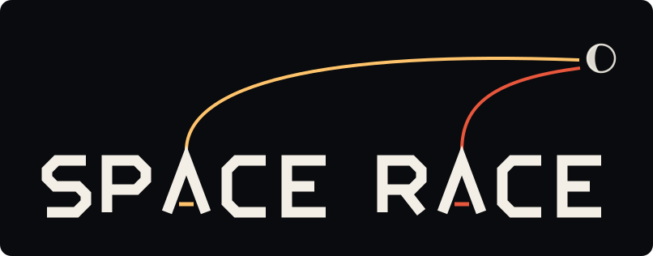

<p align="center"></p>

# Space Race

Every crewed spacecraft, modelled to scale and shown as it flew, in the place it flew from. The
first one built is **Freedom 7**, the Mercury capsule that carried Alan Shepard on 5 May 1961 on
its Redstone booster. It was the second crewed spaceflight (Yuri Gagarin had orbited the Earth in
Vostok 1 twenty-three days earlier) and it is the standard every later flight here is built to.

**Live: https://jamesbrink.online/space-race/**

```sh
pnpm install
pnpm dev        # http://localhost:5180
pnpm check      # typecheck, lint, format check, tests
pnpm models     # rebuild the models (needs Blender 5)
```

Each flight is one scene with three things to study: its **vehicle**, standing on its **launch
pad**, with its **crew**. Choosing a section, or clicking a model, flies the camera there. And it
can be flown.

- **Look.** Drag to orbit, scroll to zoom, or let the view drift round on its own; `C` steps through
  the camera's views and the screen says which one it is in. Choose a part to fly to it and read
  about it; click a window to look in.
- **Fly it.** **Fly it** by the clock (or `L`) puts the vehicle on the pad under your hands: `Space`
  lights the engine and then sets off each event, `W A S D` steer, `G` hands the steering to the
  guidance or takes it back. It is a rigid body under real gravity, air and thrust, flown from the
  flight's own recorded figures; at the end your flight is set beside the one that was flown.
- **Watch it fly.** Run the clock (`P`) and the recorded flight goes from liftoff to splashdown,
  with the simulator's run laid against the reports' figures in the **Flight** tab.
- **Take it apart.** The slider explodes the vehicle; on the pad it runs the morning of the launch,
  from the gantry round the rocket to the pad cleared. **Cutaway** opens the capsule and booster.
- **The gallery.** **Gallery** shows the vehicle alone in a studio (the stack, the spacecraft or the
  booster): taken apart with every part named, cut open, a person beside it for scale.
- **Walk.** `V`, the **Walk** button in the Crew section, or a double-click on the pilot puts you
  on the pad on foot; Space jumps.
- **Cel shading** (or `T`) redraws the whole scene as an inked drawing.
- **Check the numbers.** The **Specs** and **Motors** tabs mark each figure as documented, derived
  or estimated.

The legend at the bottom left of the page lists every key and gesture.

| Flight | Nation | Date | Record | Models |
| --- | --- | --- | --- | --- |
| Mercury-Redstone 3, *Freedom 7* | USA | 5 May 1961 | [flight](missions/usa/mercury/flights/mr-3-freedom-7/README.md) · [spacecraft](missions/usa/mercury/flights/mr-3-freedom-7/spacecraft.md) · [launch vehicle](missions/usa/mercury/vehicles/redstone-mrlv.md) · [pad](missions/usa/mercury/sites/lc-5.md) · [suit](missions/usa/mercury/crew/mark-iv-suit.md) | [capsule](missions/usa/mercury/flights/mr-3-freedom-7/model/vehicle.py) · [booster](missions/usa/mercury/vehicles/redstone_mrlv.py) · [pad](missions/usa/mercury/sites/lc5/) · [suit](missions/usa/mercury/crew/mark_iv_suit.py) |
| Vostok 1 (spacecraft only, so far) | USSR | 12 April 1961 | [flight](missions/ussr/vostok/flights/vostok-1/README.md) · [spacecraft](missions/ussr/vostok/flights/vostok-1/spacecraft.md) · [the 3KA](missions/ussr/vostok/vehicles/vostok-3ka.md) · [launch vehicle: not built](missions/ussr/vostok/vehicles/vostok-8k72k.md) · [site: not built](missions/ussr/vostok/sites/site-1.md) | [flight's fit](missions/ussr/vostok/flights/vostok-1/model/vehicle.py) · [spacecraft](missions/ussr/vostok/vehicles/vostok_3ka.py) |

## Timeline

What there is to build, in the order it flew. One flight is built whole and one has its spacecraft; the rest is the plan.

The first ten crewed flights:

| # | Date | Flight | Nation | Crew | What it was | Status |
| --- | --- | --- | --- | --- | --- | --- |
| 1 | 12 Apr 1961 | Vostok 1 | USSR | Yuri Gagarin | First person in space; one orbit | **spacecraft built** ([record](missions/ussr/vostok/flights/vostok-1/README.md)); launch vehicle, site and trajectory to come |
| 2 | 5 May 1961 | Mercury-Redstone 3, *Freedom 7* | USA | Alan Shepard | Suborbital; first American in space | **built** |
| 3 | 21 Jul 1961 | Mercury-Redstone 4, *Liberty Bell 7* | USA | Gus Grissom | Suborbital; same pad as Freedom 7 | planned (next) |
| 4 | 6 Aug 1961 | Vostok 2 | USSR | Gherman Titov | A full day in orbit | planned |
| 5 | 20 Feb 1962 | Mercury-Atlas 6, *Friendship 7* | USA | John Glenn | First American in orbit | planned |
| 6 | 24 May 1962 | Mercury-Atlas 7, *Aurora 7* | USA | Scott Carpenter | Three orbits | planned |
| 7 | 11 Aug 1962 | Vostok 3 | USSR | Andriyan Nikolayev | Four days; first of a pair | planned |
| 8 | 12 Aug 1962 | Vostok 4 | USSR | Pavel Popovich | Two crewed ships in orbit at once | planned |
| 9 | 3 Oct 1962 | Mercury-Atlas 8, *Sigma 7* | USA | Wally Schirra | Six orbits | planned |
| 10 | 15 May 1963 | Mercury-Atlas 9, *Faith 7* | USA | Gordon Cooper | A day in orbit; last Mercury | planned |

And the programmes after them:

| Programme | Nation | Crewed flights | What it adds | Status |
| --- | --- | --- | --- | --- |
| Vostok | USSR | 1961 to 1963 | The first spacecraft; Baikonur | one spacecraft built |
| Mercury | USA | 1961 to 1963 | Redstone and Atlas; Cape Canaveral | one flight built |
| Voskhod | USSR | 1964 to 1965 | Three aboard; the first spacewalk | planned |
| Gemini | USA | 1965 to 1966 | Two aboard, Titan II, rendezvous and docking | planned |
| Soyuz | USSR, Russia | 1967 onward | The longest-serving crewed spacecraft | planned |
| Apollo | USA | 1968 to 1972 | Saturn IB and Saturn V; lunar orbit and the Moon | planned |
| Salyut, Skylab, Apollo-Soyuz | USSR, USA | 1971 to 1986 | The first space stations | planned |
| Space Shuttle, Mir | USA, USSR and Russia | 1981 to 2011 | A reusable orbiter; a station built in orbit | planned |
| International Space Station | many | 1998 onward | A station crewed without a break since 2000 | planned |
| Shenzhou and Tiangong | China | 2003 onward | China's crewed spacecraft and its own stations | planned |
| Commercial crew | USA | 2020 onward | Crew Dragon and Starliner | planned |
| Artemis | USA and partners | 2020s | Orion and the Space Launch System; back to the Moon | planned |

The dates and crews above are the published ones; each flight's own record, with sources, is
written when the flight is built.

## How it is made

The models are generated by Python scripts run through Blender, so every dimension is a line of
code with a comment, and each is built at three levels of detail. The simulator is plain TypeScript
(`src/sim/`): every input carries how sure we are of it, nothing is fitted to make a result come
out, and where it misses the record the miss is written down. The rules are in
[AGENTS.md](AGENTS.md), with the detail of each part under [docs/agents/](docs/agents/). What it
all rests on is in [docs/sources.md](docs/sources.md).

Where this is going: a simulator in which you run a space programme (USA, USSR, and those that
came later) from the first flights to the present, on hardware modelled to its real specifications.

---

Copyright © 2026 James Brink
