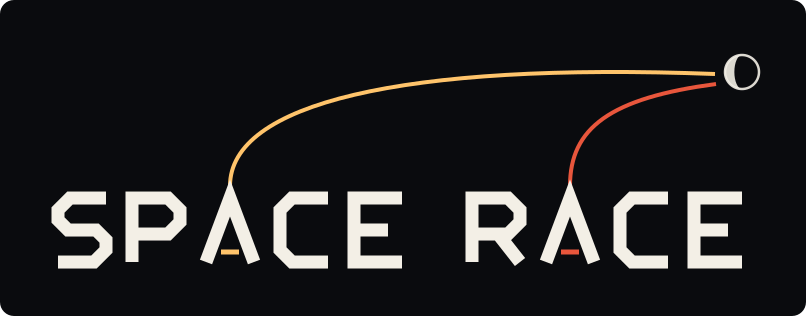
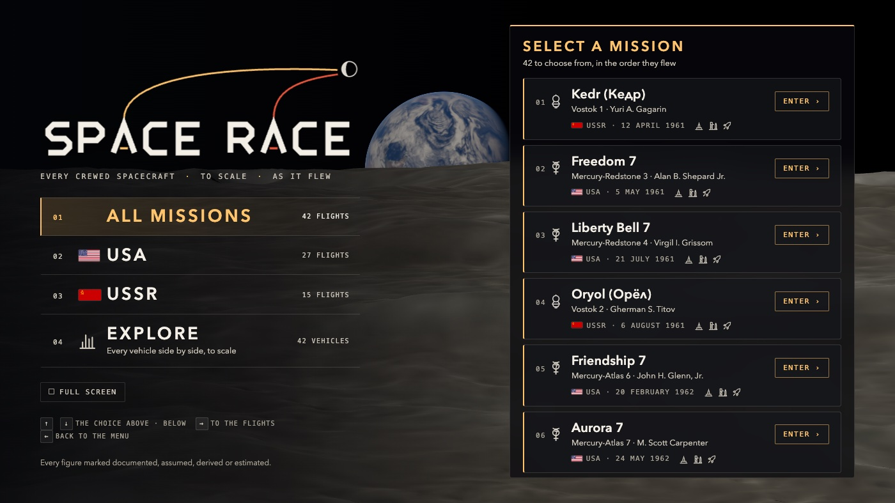
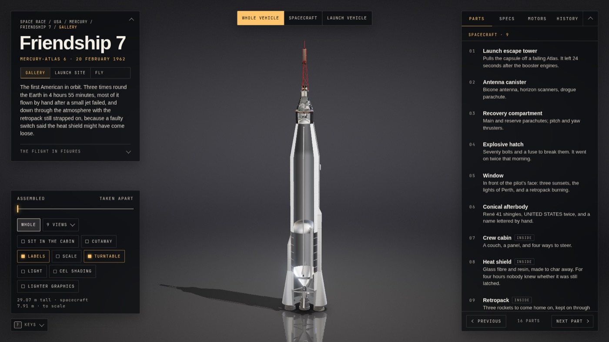
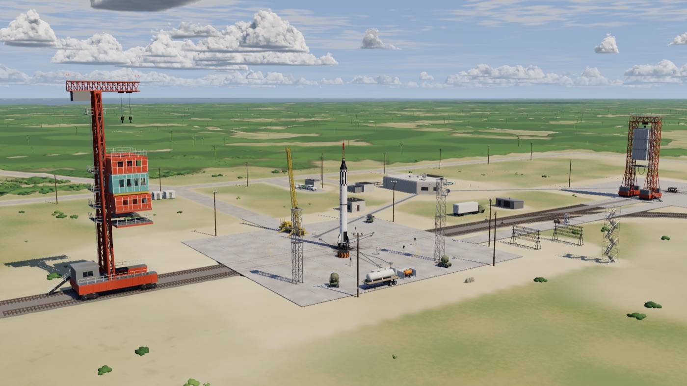
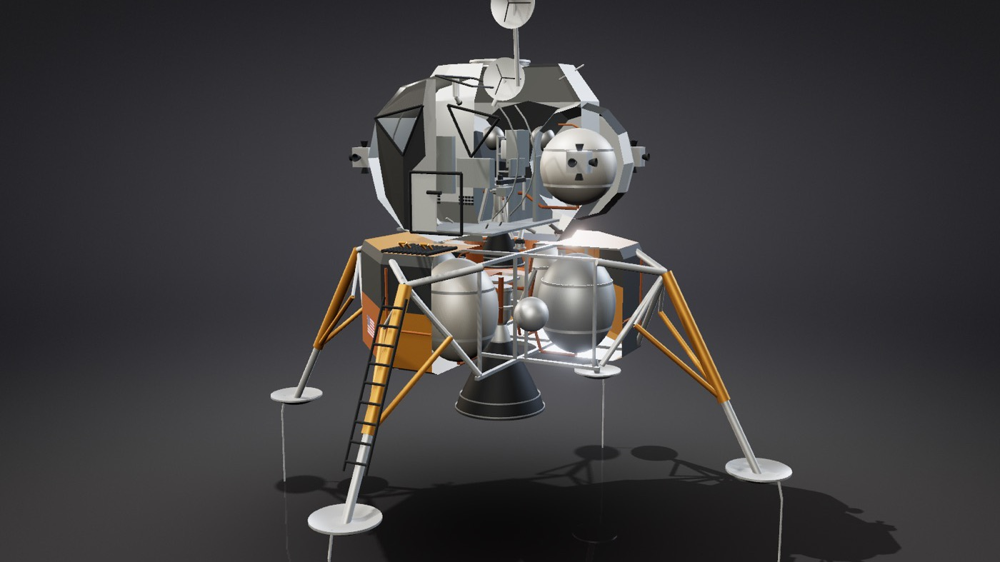
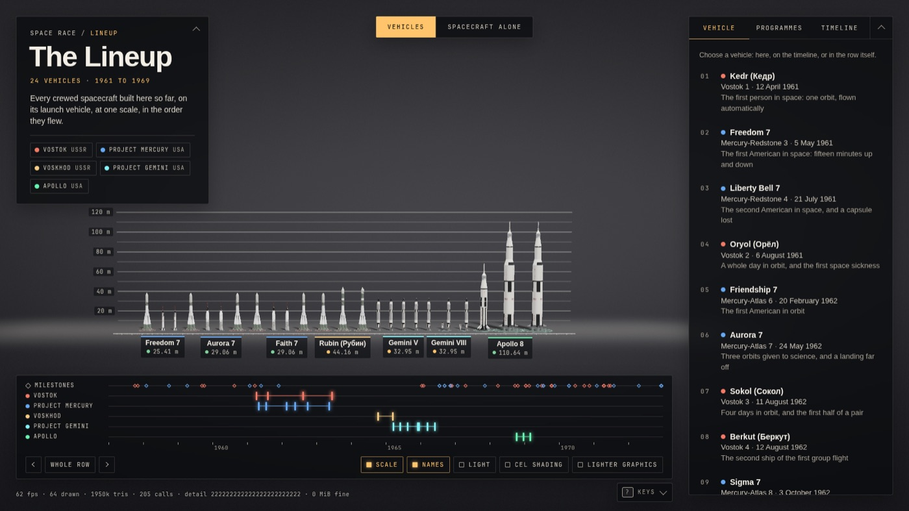

<p align="center"></p>

# Space Race

**Every crewed spacecraft, modelled to scale, in the place it flew from, on the day it flew.**

Space Race is a simulator of crewed spaceflight that runs in the browser, built flight by flight from
the historical record. Each spacecraft and its launch vehicle is modelled from drawings and reports,
stands at its launch site as that site was that morning, under that day's Sun, Moon and weather, and
can be flown from liftoff to landing: as it was flown, or by your own hand.

**24 flights so far, Vostok 1 (April 1961) to Apollo 9 (March 1969).** All of them are in the Gallery,
21 stand at their launch site, and 15 can be flown.

### [Open it: jamesbrink.online/space-race](https://jamesbrink.online/space-race/)

<p align="center">
  <a href="https://jamesbrink.online/space-race/"></a>
</p>

## What is in it

<table>
  <tr>
    <td width="50%"></td>
    <td width="50%"></td>
  </tr>
  <tr>
    <td><b>Gallery.</b> Friendship 7 on its Atlas, every part named.</td>
    <td><b>Launch site.</b> Complex 5 at Cape Canaveral on the morning of 5 May 1961.</td>
  </tr>
  <tr>
    <td></td>
    <td></td>
  </tr>
  <tr>
    <td><b>Cutaway.</b> Apollo 9's lunar module, Spider, opened to its tanks and cabin.</td>
    <td><b>The Lineup.</b> Every vehicle at one scale, in the order they flew.</td>
  </tr>
</table>

Every flight has the same three places, and opens in the first. One that is not built yet is shown
and says why.

- **Gallery.** The vehicle alone in a studio. Take it apart with the slider, cut it open, read what
  each part is and why it is the way it is, put a person beside it for scale, and sit in the cabin to
  look out of its windows.
- **Launch site.** The pad as it stood that day, with what stood round it at its real distance and
  bearing. The clock runs the morning of the launch: the gantry rolls back, the trucks leave, the
  vehicle goes. Get down and walk it as the crew, climb the structure, drive the vehicles, work the
  machines by hand, by day or by night.
- **Fly.** The recorded flight plays from liftoff to landing on real gravity, air and thrust. Take it
  over at any moment and fly it yourself from the flight deck, with a navball and a predicted path;
  do something out of order and you get what the hardware would have done.

And two that belong to no one flight:

- **The Lineup.** Every vehicle built so far on one floor at one scale, a person beside each, with a
  timeline of the race under the row. Stand two together to compare them, or see the spacecraft alone.
- **The front page.** The list of flights over the Earth, seen from out by the Moon.

The whole thing can be redrawn as an inked, cel-shaded drawing (`T`), and works on a phone.

## Flights

A dot is a place that is built; a point, one that is not yet. Each flight links to its own record:
what happened, the timeline, the sources, and the notes on its hardware.

| Flight | Launched | Crew | Launch vehicle | Gallery | Launch site | Fly |
| --- | --- | --- | --- | :-: | :-: | :-: |
| [Vostok 1, *Kedr*](missions/ussr/vostok/flights/vostok-1/README.md) | 12 Apr 1961 | Gagarin | Vostok 8K72K | ● | ● | ● |
| [Mercury-Redstone 3, *Freedom 7*](missions/usa/mercury/flights/mr-3-freedom-7/README.md) | 5 May 1961 | Shepard | Mercury-Redstone | ● | ● | ● |
| [Mercury-Redstone 4, *Liberty Bell 7*](missions/usa/mercury/flights/mr-4-liberty-bell-7/README.md) | 21 Jul 1961 | Grissom | Mercury-Redstone | ● | ● | ● |
| [Vostok 2, *Oryol*](missions/ussr/vostok/flights/vostok-2/README.md) | 6 Aug 1961 | Titov | Vostok 8K72K | ● | ● | ● |
| [Mercury-Atlas 6, *Friendship 7*](missions/usa/mercury/flights/ma-6-friendship-7/README.md) | 20 Feb 1962 | Glenn | Mercury-Atlas | ● | ● | ● |
| [Mercury-Atlas 7, *Aurora 7*](missions/usa/mercury/flights/ma-7-aurora-7/README.md) | 24 May 1962 | Carpenter | Mercury-Atlas | ● | ● | ● |
| [Vostok 3, *Sokol*](missions/ussr/vostok/flights/vostok-3/README.md) | 11 Aug 1962 | Nikolayev | Vostok 8K72K | ● | ● | ● |
| [Vostok 4, *Berkut*](missions/ussr/vostok/flights/vostok-4/README.md) | 12 Aug 1962 | Popovich | Vostok 8K72K | ● | ● | ● |
| [Mercury-Atlas 8, *Sigma 7*](missions/usa/mercury/flights/ma-8-sigma-7/README.md) | 3 Oct 1962 | Schirra | Mercury-Atlas | ● | ● | ● |
| [Mercury-Atlas 9, *Faith 7*](missions/usa/mercury/flights/ma-9-faith-7/README.md) | 15 May 1963 | Cooper | Mercury-Atlas | ● | ● | ● |
| [Vostok 5, *Yastreb*](missions/ussr/vostok/flights/vostok-5/README.md) | 14 Jun 1963 | Bykovskiy | Vostok 8K72K | ● | ● | ● |
| [Vostok 6, *Chayka*](missions/ussr/vostok/flights/vostok-6/README.md) | 16 Jun 1963 | Tereshkova | Vostok 8K72K | ● | ● | ● |
| [Voskhod 1, *Rubin*](missions/ussr/voskhod/flights/voskhod-1/README.md) | 12 Oct 1964 | Komarov, Feoktistov, Yegorov | Voskhod 11A57 | ● | ● | ● |
| [Voskhod 2, *Almaz*](missions/ussr/voskhod/flights/voskhod-2/README.md) | 18 Mar 1965 | Belyayev, Leonov | Voskhod 11A57 | ● | ● | ● |
| [Gemini 3, *Molly Brown*](missions/usa/gemini/flights/gt-3/README.md) | 23 Mar 1965 | Grissom, Young | Titan II GLV | ● | ● | ● |
| [Gemini IV](missions/usa/gemini/flights/gt-4/README.md) | 3 Jun 1965 | McDivitt, White | Titan II GLV | ● | ● | · |
| [Gemini V](missions/usa/gemini/flights/gt-5/README.md) | 21 Aug 1965 | Cooper, Conrad | Titan II GLV | ● | ● | · |
| [Gemini VII](missions/usa/gemini/flights/gt-7/README.md) | 4 Dec 1965 | Borman, Lovell | Titan II GLV | ● | ● | · |
| [Gemini VI-A](missions/usa/gemini/flights/gt-6a/README.md) | 15 Dec 1965 | Schirra, Stafford | Titan II GLV | ● | ● | · |
| [Gemini VIII](missions/usa/gemini/flights/gt-8/README.md) | 16 Mar 1966 | Armstrong, Scott | Titan II GLV | ● | ● | · |
| [Gemini IX-A](missions/usa/gemini/flights/gt-9a/README.md) | 3 Jun 1966 | Stafford, Cernan | Titan II GLV | ● | ● | · |
| [Apollo 7](missions/usa/apollo/flights/apollo-7/README.md) | 11 Oct 1968 | Schirra, Eisele, Cunningham | Saturn IB | ● | · | · |
| [Apollo 8](missions/usa/apollo/flights/apollo-8/README.md) | 21 Dec 1968 | Borman, Lovell, Anders | Saturn V | ● | · | · |
| [Apollo 9, *Gumdrop* and *Spider*](missions/usa/apollo/flights/apollo-9/README.md) | 3 Mar 1969 | McDivitt, Scott, Schweickart | Saturn V | ● | · | · |

Four launch sites are built: Site 1 at Tyuratam (Vostok and Voskhod), and Complexes 5
(Mercury-Redstone), 14 (Mercury-Atlas) and 19 (Gemini) at Cape Canaveral. A site is built once and
dated, so a later flight from the same pad adds what had changed and keeps the rest.

## The numbers are labelled

The models are the inventory for a simulator, so they have to be right, and where they are not yet
right the repository says so.

- Every figure carries how sure we are of it: **documented** (a published figure, with its document
  and page), **assumed** (the type's figure, taken for this unit), **derived** (computed from
  documented ones) or **estimated** (read off photographs). The Specs and Motors tabs show which.
- The simulator refuses to depend on estimates, fits nothing to make a result come out, and where
  its run misses the record the miss is written down.
- Each hardware note ends with what its model gets wrong or leaves out.
- The Sun, Moon and planets are placed from JPL's DE440 ephemeris, the weather from the day's
  observations and ERA5. Nothing in the sky is placed by hand.

[docs/sources.md](docs/sources.md) is the bibliography, including what we know of and have not read.

## Keys

The legend at the bottom left of the page (`?`) lists every key and gesture for where you are. The
ones worth knowing first:

| Where | Keys |
| --- | --- |
| Anywhere | drag to orbit, scroll to zoom · `T` cel shading · `H` hide the panels |
| Gallery | `Y` cutaway · `C` sit in the cabin · `G` a person for scale · `N` `B` the next part, the one before |
| Launch site | `P` run or stop the clock · `[` `]` slower, faster · `C` the next camera · `V` walk as the crew · `U` sound |
| On foot | `W` `A` `S` `D` walk · `Shift` run · `Space` jump · `E` act on what you face · `C` eyes or over the shoulder |
| Fly | `L` fly it yourself · `Space` the next event · `W` `S` `A` `D` `Q` `E` pitch, yaw, roll · `G` guidance · `J` path · `I` navball |
| The Lineup | `P` spacecraft alone · `X` stand another beside it · `O` open its gallery |

## Run it

```sh
pnpm install
pnpm dev        # http://localhost:5180, with hot reload
pnpm check      # typecheck, lint, format check, tests
pnpm build      # a production bundle in dist/
```

The models are committed, so Blender is needed only to change one: `pnpm model <flight>` rebuilds a
flight's GLBs from its scripts with Blender 5, headless. `nix develop` gives a shell with everything
the checks need.

## How it is made

- **Models** are Python scripts run through Blender, in the units of the drawings they came from, so
  every dimension is a line of code with its source beside it. Each is built at three levels of detail.
- **The viewer** is three.js and strict TypeScript with no framework. Positions are doubles drawn from
  the eye, so a pad on a full-size Earth and a lunar module's switch panel share one scene.
- **The world** (`src/world/`) is the Earth to scale, the Moon, the Sun and the clock, tested against
  published values. **The simulator** (`src/sim/`) is a rigid body under gravity, air and thrust.
- **Sound** is synthesised; there are no audio files.

```
missions/<nation>/<programme>/flights/<flight>/   a flight: its data, its record, its model scripts
missions/<nation>/<programme>/vehicles/, crew/    hardware shared between flights, each with its notes
missions/<nation>/places/<place>/                 a launch site and what stood there, dated
src/                                              world, sim, viewer, flight deck, app and UI
docs/agents/                                      the rules for each part of the code
```

[AGENTS.md](AGENTS.md) holds the working rules, and [docs/agents/layout.md](docs/agents/layout.md)
says what every file is for.

## Where it is going

An orbital space programme for our own solar system, flown from the first flights to the present on
hardware modelled to its real specifications, with a person's presence on the ground as well as a
pilot's in the seat. The programmes, in the order they flew:

| Programme | Nation | Crewed flights | Built |
| --- | --- | --- | --- |
| Vostok | USSR | 1961 to 1963 | all 6 |
| Mercury | USA | 1961 to 1963 | all 6 |
| Voskhod | USSR | 1964 to 1965 | both |
| Gemini | USA | 1965 to 1966 | 7 of 10 |
| Soyuz | USSR, Russia | 1967 onward | |
| Apollo | USA | 1968 to 1972 | 3 of 11 |
| Salyut, Skylab, Apollo-Soyuz | USSR, USA | 1971 to 1986 | |
| Space Shuttle, Mir | USA, USSR and Russia | 1981 to 2011 | |
| International Space Station | many | 1998 onward | |
| Shenzhou and Tiangong | China | 2003 onward | |
| Commercial crew | USA | 2020 onward | |
| Artemis | USA and partners | 2020s | |

The next flights are listed in [missions/upcoming.ts](missions/upcoming.ts); what is open is in the
[issues](https://github.com/jamesbrink/space-race/issues).

## Licence

The code and the models are under the [MIT licence](LICENSE). The data baked into `public/` that
came from others keeps its own terms (OpenStreetMap's ODbL, the Copernicus licence, NASA's
guidelines), which [docs/sources.md](docs/sources.md) records beside each source.

---

Copyright © 2026 James Brink
