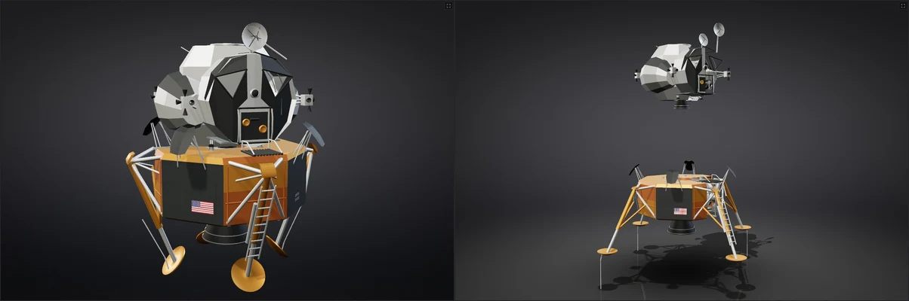

# Apollo 11 · Columbia and Eagle

On 16 July 1969 Neil Armstrong, Michael Collins and Edwin Aldrin Jr. left Kennedy Space Center on SA-506. Four hours into the flight Collins had turned Columbia around, docked with the lunar module and drawn it out of the adapter. Eagle landed at 102:45:39.9 ground elapsed time. Its descent stage stayed at Tranquility Base. Its ascent stage brought Armstrong and Aldrin back to Collins. The command module splashed down at 195:18:35. [Apollo 11 Mission Report, table 3-I](https://www.nasa.gov/wp-content/uploads/static/apollo50th/pdf/A11_MissionReport.pdf)

In the **Gallery**, start at SA-506 and open the cutaway to follow the engines, tanks and instrument unit up to Eagle, folded under the service engine. Take a couch in Columbia. Aldrin occupied the centre seat for launch, Collins the right. In the separate Eagle exhibit, take either standing station or inspect the science bay and television camera. Move its slider to see which hardware remained on the surface. In the **Lineup**, compare Apollo 11 with Apollo 10 at their real heights. The exhibits use studio lighting. [Hardware and reconstruction notes](spacecraft.md) · [Apollo 11 flight plan, crew positions](https://www.nasa.gov/wp-content/uploads/static/apollo50th/pdf/a11final-fltpln.pdf)
