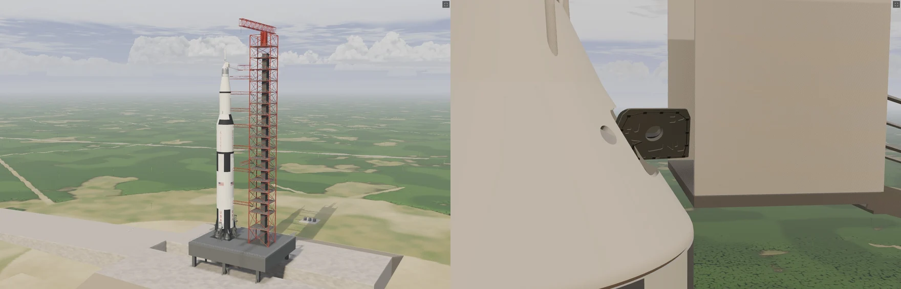

# Apollo 11 · Columbia and Eagle

On 16 July 1969 Neil Armstrong, Michael Collins and Edwin Aldrin Jr. left Kennedy Space Center on SA-506. Four hours into the flight Collins had turned Columbia around, docked with the lunar module and drawn it out of the adapter. Eagle landed at 102:45:39.9 ground elapsed time. Its descent stage stayed at Tranquility Base. Its ascent stage brought Armstrong and Aldrin back to Collins. The command module splashed down at 195:18:35. [Apollo 11 Mission Report, table 3-I](https://www.nasa.gov/wp-content/uploads/static/apollo50th/pdf/A11_MissionReport.pdf)

In the **Gallery**, start at SA-506 and open the cutaway to follow the engines, tanks and instrument unit up to Eagle, folded under the service engine. Take a couch in Columbia. Aldrin occupied the centre seat for launch, Collins the right. In the separate Eagle exhibit, take either standing station or inspect the science bay and television camera. Move its slider to see which hardware remained on the surface. In the **Lineup**, compare Apollo 11 with Apollo 10 at their real heights. The exhibits use studio lighting. [Hardware and reconstruction notes](spacecraft.md) · [Apollo 11 flight plan, crew positions](https://www.nasa.gov/wp-content/uploads/static/apollo50th/pdf/a11final-fltpln.pdf)

## Launch site

SA-506 stands on mobile launcher 1 at Pad 39A. The site opens at **06:54 EDT** on 16 July 1969, when Armstrong entered Columbia. Choose a crew member and follow the approach ramp, launcher stairs and tower elevator. Leave the elevator at level 320, cross arm 9 and board through the white room. Collins entered at 07:00 and Aldrin at 07:07. The closeout crew shut the hatch at 07:25. The initial positions on the ramp and the shared A7L suits are representative. [NASA mission overview](https://www.nasa.gov/missions/apollo/apollo-11/apollo-11-mission-overview/) · [Launch Control transcript](https://apollojournals.org/afj/ap11fj/01launch.html#t-0023444)

At T−50 minutes Launch Control ordered arm 9 to its 12° standby position. At T−5 minutes the arm began its final retraction. By T−4:48 the crew heard it was fully retracted. The launch-vehicle evaluation gives first motion at T+0.3 seconds. The spacecraft mission report lists liftoff at T+0.6 seconds. The countdown uses first motion for the five inflight service arms. [Countdown transcript](https://apollojournals.org/afj/ap11fj/01launch.html#t-0004958) · [AS-506 Flight Evaluation Report, §§3.6 and 4, table 4-1](https://www.ibiblio.org/apollo/Documents/lvfea-AS506-Apollo11.pdf) · [Pad hardware and reconstruction limits](../../../places/cape-canaveral/lc-39.md)

At range zero, **09:32 EDT**, the Sun was 36.5° above the horizon at azimuth 83.5° true. The Moon was 14.7° up at 76.4°. The KSC station reported ten statute miles of visibility, one tenth cumulus at 2,400 ft, two tenths altocumulus at 15,000 ft, and nine tenths cirrostratus. The report gives no base for the high layer. Its displayed height and optical depth are estimates. The southeast pad light pole measured a 3.3 m/s wind from 175°. The weather map reconstructs the observed cover. The individual clouds and their positions are illustrative. [AS-506 Flight Evaluation Report, appendix A and table A-1](https://www.ibiblio.org/apollo/Documents/lvfea-AS506-Apollo11.pdf) · [Weather inputs and sources](weather.ts)

## Fly

Fly takes the flight deck at the pad: SA-506 under your hands from ignition through the translunar injection. On entry
guidance (G) and the sequencer (B) are off and Hold is on: you light the five F-1s, steer on the outboard engines' gimbals
(Hold keeping the attitude your keys leave), cut the centre and the four, let the S-IC go, light the S-II, drop its aft
interstage and the escape tower, cut and stage again, light the S-IVB into the parking orbit, and light it once more for
the injection. Each act does what the hardware would: a stage let go under thrust stays pressed on, the J-2 cannot be lit
again while it burns, and the stack in orbit turns only as fast as the S-IVB's small attitude jets allow. With G and B on,
the record's ascent (its S-IC programme, its guidance's closed loop, its events at their times) makes the parking orbit and
the injection. The run, and how it compares with the record, is in [mission.md](mission.md), from MSFC's flight
evaluation of SA-506 (MPR-SAT-FE-69-9).

The flight ends with the injection: the stack, whole, coasts on toward the Moon, which pulls on it. What came next is not
flown.

## What is not flown or is simplified

- Nothing after the S-IVB's second cutoff: the transposition and docking, Eagle drawn out of the adapter, the S-IVB sent
  past the Moon, the lunar orbit, the landing and the return. The stack coasts on whole.
- The aborts are said, not flown: the escape tower (Mode I), and Modes II, III and IV (press kit, p. 78).
- The S-IC flies flatter than the record on the record's own attitude commands (mission.md); the iterative guidance is a
  linear tangent in each of its two burns; the engines' starts and cutoff transients, the tower clearance yaw, the S-IVB's
  boil-off in orbit and the J-2's cutoff impulse at the injection are not flown.
