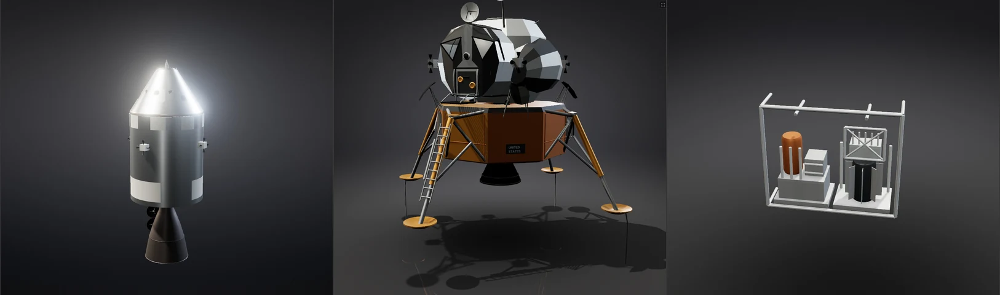
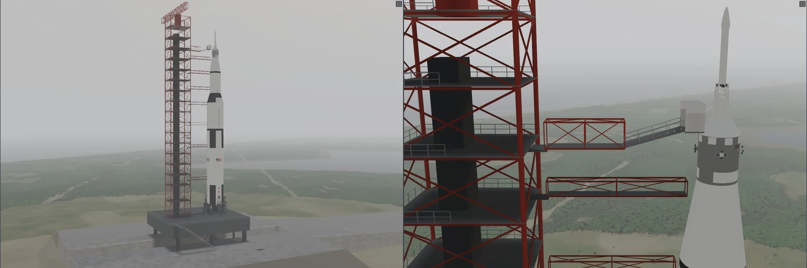

# Apollo 12 · Yankee Clipper and Intrepid

Charles Conrad Jr., Richard F. Gordon Jr. and Alan L. Bean launched on SA-507 on November 14, 1969. Two lightning discharges in the first minute disrupted the spacecraft’s electrical systems. The launch vehicle continued under the guidance of its own instrument unit. Four days later Conrad and Bean brought Intrepid down in the Ocean of Storms within walking distance of Surveyor III. On their second excursion they recovered parts of the robotic lander, including its television camera. Gordon stayed in lunar orbit aboard Yankee Clipper. All three returned to the Pacific on November 24. [Apollo 12 Mission Report, §§1, 3 and 10](https://www.nasa.gov/wp-content/uploads/2025/11/a12-missionreport.pdf)

In the **Gallery**, open the cutaway of SA-507 to see Intrepid folded into SLA-15 beneath the service engine. Separate the adapter panels and follow the lander out before its legs deploy. Choose Yankee Clipper to inspect the command module, its three couches and the service module. In Intrepid’s separate exhibit, take either standing station or separate the stages to see what stayed on the Moon. The two ALSEP packages and their power equipment rode on the descent stage. The fuel capsule travelled in its own protective cask outside the lander. [Apollo 12 Press Kit, lunar surface experiments](https://science.nasa.gov/wp-content/uploads/2023/09/Apollo_12.pdf)

In the **Lineup**, select Apollo 12 in the Apollo section to compare the full 363-foot stack with Apollo 11 at the same scale. The spacecraft-only view removes the launch vehicle.

## Launch site

SA-507 stands on mobile launcher 2 at Pad 39A. The site clock starts at T−12 hours with the S-II aft access arm still alongside the vehicle. Its early withdrawal time is estimated. Set the clock to **T−2:49 (08:33 EST on 14 November)** for crew ingress, when Pete Conrad crossed Yankee Clipper’s hatch sill. Choose a crew member, climb the launcher stairs, ride the tower elevator to level 320 and cross arm 9 into the white room. Bean boarded second at 08:39 and Gordon third at 08:46. The closeout crew shut the hatch at about 09:05. The starting positions on the approach and the fits of the A7L suits are representative. [Kennedy Launch Control, crew ingress and hatch closure](https://www.apollojournals.org/afj/ap12fj/01launch_to_earth_orbit.html)

By the T−29:54 broadcast arm 9 had reached its 12° standby position. Launch Control called its final withdrawal at T−5:00. The model uses the flight manual’s nominal timing where the broadcast gives no exact endpoint. At T+0.25 s the four hold-down arms released within eight milliseconds of one another. The IU umbilical disconnected at T+0.7 s. The evaluation team reconstructed tower clearance from flight data because camera measurements of liftoff motion were unavailable. [AS-507 flight evaluation, table 2-2 and §§3.6.1, 11.2.1](https://www.ibiblio.org/apollo/Documents/lvfea-AS507-Apollo12.pdf) · [SA-507 flight manual, fig. 8-20](https://www.apollojournals.org/afj/ap12fj/pdf/a12_sa507-flightmanual.pdf) · [Pad hardware and reconstruction limits](../../../places/cape-canaveral/lc-39.md)

At range zero, **11:22 EST**, the Sun was 41.8° above the horizon at azimuth 165.6° true. The Moon was 5.0° below the horizon at 116.3°. Kennedy reported ten tenths stratocumulus with a ceiling estimated at 2,100 ft and 6 km visibility. The southeast pad pole measured 6.8 m/s from 280°. The rendered deck represents that ceiling. Its thickness is simplified, and the showers and two electrical discharges appear in the historical record only. [AS-507 flight evaluation, appendix A and table A-1](https://www.ibiblio.org/apollo/Documents/lvfea-AS507-Apollo12.pdf) · [Weather inputs](weather.ts)

## Hardware notes

- [SA-507 and adapter SLA-15](../../vehicles/sa-507.md)
- [CSM-108 Yankee Clipper](../../vehicles/csm-108.md)
- [LM-6 Intrepid](../../vehicles/lm-6.md)

## Fly

Fly takes the flight deck at the pad: SA-507 under your hands from ignition through the translunar injection. On entry
guidance (G) and the sequencer (B) are off and Hold is on: you light the five F-1s, steer on the outboard engines' gimbals
(Hold keeping the attitude your keys leave), cut the centre and the four, let the S-IC go, light the S-II, drop its aft
interstage and the escape tower, cut the S-II's centre engine early and the four after it, stage again, light the S-IVB into the parking orbit, and light it once more for
the injection. Each act does what the hardware would: a stage let go under thrust stays pressed on, an engine lit into a
closed interstage breaks the stack up, the J-2 cannot be lit again while it burns, and the stack in orbit turns only as
fast as the S-IVB's small attitude jets allow. With G and B on, the record's ascent (its S-IC programme, its guidance's
closed loop, its events at their times) makes the parking orbit and the injection. The run, and how it compares with the
record, is in [mission.md](mission.md), from MSFC's flight evaluation of SA-507 (MPR-SAT-FE-70-1).

The flight ends with the injection: the stack, whole, Intrepid in the adapter, coasts on toward the Moon, which pulls on it. What came
next is not flown.

## What is not flown or is simplified

- Nothing after the S-IVB's second cutoff: the transposition and docking, Intrepid drawn out of the adapter, the S-IVB sent past the Moon, the lunar orbit, the landing and the return. The stack coasts on whole.
- The aborts are said, not flown: the escape tower (Mode I), and Modes II, III and IV (abort boundaries assumed from Apollo 11's press kit, p. 78: Apollo 12's has no table of them).
- The S-IC holds the record on this flight's own pitch programme, but the S-II falls short of the record's speed and
  height and the S-IVB makes up the difference, cutting 11 to 15 seconds late (mission.md, `MISSES`); the iterative
  guidance is a linear tangent in each of its two burns; the engines' starts and cutoff transients, the tower clearance
  yaw, the S-IVB's boil-off in orbit and the J-2's cutoff impulse at the injection are not flown.
- The two lightning discharges, at 36.5 and 52 seconds, are not flown. They dropped the fuel cells off the spacecraft's
  buses and cost its platform its attitude reference; the launch vehicle's guidance flew on unharmed and the trajectory stayed close to the
  planned one, so nothing in the path is theirs to show (mission.md; AS-507 flight evaluation, Section 12A; mission
  report, §14.1.3).
