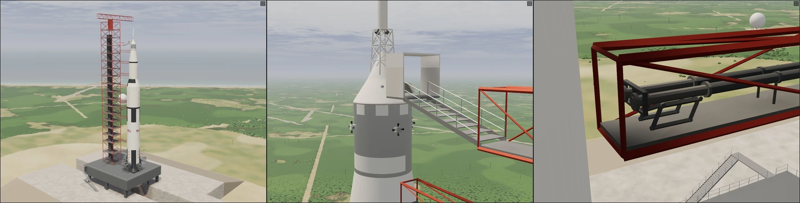

# Apollo 13 · Odyssey and Aquarius

SA-508 lifted off on 11 April 1970 with Jim Lovell, Jack Swigert and Fred Haise aboard Odyssey. The S-II stage lost its centre J-2 engine 132 seconds early after severe longitudinal oscillations. The other four engines continued firing, and the S-IVB made up the remaining velocity shortfall. Swigert docked Odyssey with Aquarius 3 hours 19 minutes after launch and drew it out of adapter SLA-16. The upper stage continued to the Moon, where its impact was recorded by the seismometer Apollo 12 had left behind. [AS-508 flight evaluation, §§2, 6 and 8](https://www.ibiblio.org/apollo/Documents/lvfea-AS508-Apollo13.pdf) · [Apollo 13 Mission Report, table 3-I and §4](https://www.apollojournals.org/afj/ap13fj/pdf/a13-mission-report-197007.pdf)

In the **Gallery**, start with the complete Saturn V. Open its cutaway to find Aquarius folded beneath Odyssey’s service engine. Inspect the cryogenic oxygen shelf in the service module and take any of Odyssey’s three launch couches. Lovell sat on the left, Swigert in the centre and Haise on the right. Swigert flew in Ken Mattingly’s place. [Kennedy Launch Control, boarding transcript](https://apollojournals.org/afj/ap13fj/01launch_ascent.html)

Oxygen tank 2 failed at 55:54:53 ground elapsed time. All three astronauts relied on Aquarius for air and electrical power while Odyssey was shut down. The crew deployed the landing gear before using the descent engine to restore a free-return trajectory. A second burn after the lunar flyby shortened the trip home. In the separate **Aquarius** exhibit, inspect the cabin equipment the crew used on the return alongside the surface payload they carried for Fra Mauro. The ascent and descent stages stayed together when the crew jettisoned Aquarius shortly before entry. Odyssey splashed down on 17 April. [Mission report, §§3, 6.7 and 8](https://www.apollojournals.org/afj/ap13fj/pdf/a13-mission-report-197007.pdf) · [Crew transcript, gear deployment](https://apollojournals.org/afj/ap13fj/10day3-free-return.html)

In the **Lineup**, compare SA-508 with Apollo 12 at the same scale. Both stacks stood about 363 ft tall. The spacecraft-only view brings the payload down to the comparison floor.

## Launch site

On 11 April 1970, **mobile launcher 3 stood at Pad A**. The site clock opens at T−12 hours. For boarding, set it to T−2:41 (11:32 EST) and follow Lovell from the approach stairs up the tower elevator to level 320. Haise entered six minutes after Lovell and Swigert six minutes after Haise. Their starting positions and A7L suit fits are representative. The closeout crew had already opened Odyssey during the T−3:30 hold. Launch Control authorized closing the pressure hatch at T−2:12:23 and separately reported the boost protective cover closed at T−1:29:57. The modeled door strokes are estimates. [Kennedy Launch Control, crew ingress and closeout](https://www.apollojournals.org/afj/ap13fj/01launch_ascent.html)

Arm 9 took the white room back to its 12° standby position around T−43 minutes and moved to full retraction at T−5 minutes. SA-508 first moved at T+0.30 s. The instrument unit sensed its umbilical disconnect at T+0.61 s. The ground event recorder failed just before launch, so the individual release and latch times cannot be read from its record. The control panels confirmed that all service arms latched. Television and panel indications confirmed that all three tail service masts retracted and their protective hoods closed within four seconds of umbilical separation. [AS-508 flight evaluation, tables 2-1 and 2-2 and §§3.6.1–3.6.2](https://www.ibiblio.org/apollo/Documents/lvfea-AS508-Apollo13.pdf) · [Dated pad hardware](../../../places/cape-canaveral/lc-39.md)

At range zero, **14:13 EST**, the Sun stood 57.2° above the horizon at azimuth 237.2° true and the Moon stood 51.2° high at 79.6°. The Merritt Island station reported 16 km visibility, four tenths altocumulus at 5,790 m and ten tenths thin cirrostratus with a base estimated at 7,925 m. The southeast pad pole measured a 6.3 m/s wind from 105°. The veil’s optical thickness is estimated. [AS-508 flight evaluation, appendix A, table A-1](https://www.ibiblio.org/apollo/Documents/lvfea-AS508-Apollo13.pdf) · [Weather inputs](weather.ts)

## Hardware notes

- [Saturn V SA-508 and SLA-16](../../vehicles/sa-508.md)
- [CSM-109 Odyssey](../../vehicles/csm-109.md)
- [LM-7 Aquarius](../../vehicles/lm-7.md)
