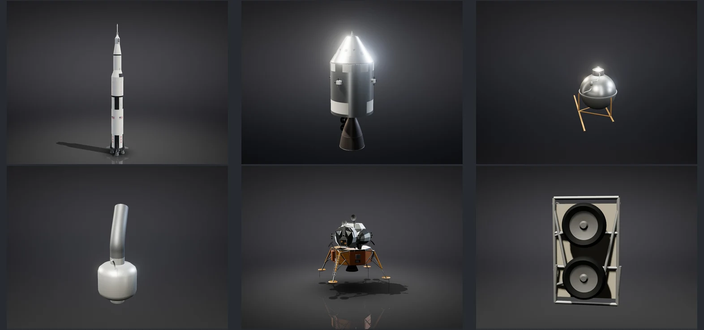

# Apollo 14 · Kitty Hawk and Antares

Alan Shepard, Stuart Roosa and Edgar Mitchell launched from Kennedy Space Center on 31 January 1971. In the Gallery, open the cutaway below Kitty Hawk’s service engine to see Antares folded inside adapter SLA-17. The four panels separated when Roosa turned Kitty Hawk around to collect Antares. Five docking attempts failed to capture. On the sixth, Roosa held the spacecraft together with thrust while the probe retracted and the docking ring latched. [Apollo 14 Mission Report, §§1 and 14.1.1](https://www.apollojournals.org/afj/ap14fj/pdf/a14_mission-report.pdf)

Take the left couch for Shepard’s view, the centre for Roosa’s and the right for Mitchell’s. The flight journal puts boarding about three hours before launch. The twenty-minute boarding window and hatch strokes in the exhibit are estimates. At T−90 on the countdown, Launch Control reported that the cabin was purged and the closeout crew was finishing the boost cover. The later weather hold places that call roughly 130 minutes before liftoff. Open Kitty Hawk’s service module to find the two original oxygen tank positions in sector IV and the third tank in sector I. The auxiliary battery on the aft bulkhead gave the crew another source of electrical power. Lower down the Saturn V, inspect the accumulator on the centre J-2 engine of the second stage. It suppressed the oscillation that had caused the centre engine on Apollo 13 to cut off early. [Flight Journal, launch](https://apollojournals.org/afj/ap14fj/01_day1_launch.html) · [Mission report, appendix A](https://www.apollojournals.org/afj/ap14fj/pdf/a14_mission-report.pdf) · [AS-509 flight evaluation, §8.2](https://www.apollojournals.org/afj/ap14fj/pdf/a14_saturn-v-fer.pdf)

The separate **Antares** exhibit shows the lander with its legs extended and surface equipment still stowed. Inspect the folded cart beside the ladder, the covered laser retroreflector, and the portable magnetometer. Shepard and Mitchell pulled the cart toward Cone Crater on their second excursion while Roosa photographed the Moon from orbit. The mission clock in the exhibit measures elapsed time from range zero throughout. The crew advanced its onboard clock by 40 minutes 2.90 seconds during the outbound coast. [Mission report, §§1–3 and table 6-I](https://www.apollojournals.org/afj/ap14fj/pdf/a14_mission-report.pdf)

In the **Lineup**, compare the 363-foot SA-509 with Apollo 13’s SA-508 at the same scale, or choose the spacecraft-only view to bring both payloads to the floor.

## Hardware notes

- [SA-509 and adapter SLA-17](../../vehicles/sa-509.md)
- [CSM-110 Kitty Hawk](../../vehicles/csm-110.md)
- [LM-8 Antares](../../vehicles/lm-8.md)
