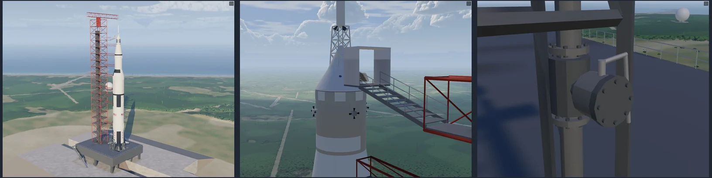

# Apollo 14 · Kitty Hawk and Antares

Alan Shepard, Stuart Roosa and Edgar Mitchell launched from Kennedy Space Center on 31 January 1971. In the Gallery, open the cutaway below Kitty Hawk’s service engine to see Antares folded inside adapter SLA-17. The four panels separated when Roosa turned Kitty Hawk around to collect Antares. Five docking attempts failed to capture. On the sixth, Roosa held the spacecraft together with thrust while the probe retracted and the docking ring latched. [Apollo 14 Mission Report, §§1 and 14.1.1](https://www.apollojournals.org/afj/ap14fj/pdf/a14_mission-report.pdf)

Take the left couch for Shepard’s view, the centre for Roosa’s and the right for Mitchell’s. The flight journal puts boarding about three hours before launch. The twenty-minute boarding window and hatch strokes in the exhibit are estimates. Open Kitty Hawk’s service module to find the two original oxygen tank positions in sector IV and the third tank in sector I. The auxiliary battery on the aft bulkhead gave the crew another source of electrical power. Lower down the Saturn V, inspect the accumulator on the centre J-2 engine of the second stage. It suppressed the oscillation that had caused the centre engine on Apollo 13 to cut off early. [Flight Journal, launch](https://apollojournals.org/afj/ap14fj/01_day1_launch.html) · [Mission report, appendix A](https://www.apollojournals.org/afj/ap14fj/pdf/a14_mission-report.pdf) · [AS-509 flight evaluation, §8.2](https://www.apollojournals.org/afj/ap14fj/pdf/a14_saturn-v-fer.pdf)

The separate **Antares** exhibit shows the lander with its legs extended and surface equipment still stowed. Inspect the folded cart beside the ladder, the covered laser retroreflector, and the portable magnetometer. Shepard and Mitchell pulled the cart toward Cone Crater on their second excursion while Roosa photographed the Moon from orbit. The mission clock in the exhibit measures elapsed time from range zero throughout. The crew advanced its onboard clock by 40 minutes 2.90 seconds during the outbound coast. [Mission report, §§1–3 and table 6-I](https://www.apollojournals.org/afj/ap14fj/pdf/a14_mission-report.pdf)

In the **Lineup**, compare the 363-foot SA-509 with Apollo 13’s SA-508 at the same scale, or choose the spacecraft-only view to bring both payloads to the floor.

## Launch site

SA-509 stood on **mobile launcher 2 at Pad 39A**. The site opens twelve hours before launch. Set the clock to three hours before launch to board. Walk from the approach up the launcher stairs, ride the tower elevator to level 320 and cross the white room into Kitty Hawk. Shepard wore red bands on his arms and legs. His site figure uses the 5 ft 11 in stature given in the press kit. Band positions, the crew’s starting positions, and the suit fits are reconstructed. Roosa wears the shared IV garment and Mitchell the EV garment. [Launch-day photograph 71PC-67](https://www.nasa.gov/wp-content/uploads/2021/02/as14-0820-71pc-67-1.31.71.jpg) · [Apollo 14 Press Kit, prime crew biographies](https://www.nasa.gov/wp-content/uploads/static/apollo50th/pdf/A14_PressKit.pdf)

The countdown and site clock diverge during the weather hold. At countdown T−90 minutes Launch Control reported the closeout crew finishing the boost cover. At T−55 it forecast that arm 9 would start moving in about 100 seconds. The T−52:13 call confirmed the white room in its 12° standby position. That call falls **1:32:15 before range zero** on the site clock. The arm remained in standby through the 40:02 hold at T−8:02. Launch Control scheduled final withdrawal for T−5 minutes on the resumed count. [Launch Control recording and transcript](https://apollojournals.org/afj/ap14fj/01_day1_launch.html) · [AS-509 launch vehicle evaluation, §3.3](https://www.apollojournals.org/afj/ap14fj/pdf/a14_saturn-v-fer.pdf)

At the base of the first stage, inspect the RP-1 cutoff valve on tail service mast 1-2. After launch the valve reopened when mast power went off, allowing residual fuel into piping in launcher room 4A. SA-509 first moved at +0.20 s and the instrument unit sensed its umbilical disconnect at +0.57 s. The three masts took 2.168 s (1-2), 2.496 s (3-2) and 2.131 s (3-4) from plate separation to retraction. The model uses first motion as the common start of those measured strokes. Hood timing, individual arm paths and local pipe contours are estimates. [AS-509 evaluation, tables 2-1, 2-2 and 3-1 and §§3.4.1 and 3.6.1](https://www.apollojournals.org/afj/ap14fj/pdf/a14_saturn-v-fer.pdf) · [Dated launch hardware](../../../places/cape-canaveral/lc-39.md)

At 16:03:02 EST the Sun was 22.0° above the horizon at azimuth 234.0° true. The Moon was 70.0° high at 148.8°. The showers had passed the pad. MILA reported 16 km visibility, seven tenths cumulus with an estimated base of 1,219 m, and two tenths altocumulus at 2,438 m. Total cover was eight tenths. The northwest light pole measured 5.0 m/s from 255° at 18.3 m above grade. The cloud field represents conditions at liftoff. Its individual clouds and drift are estimated. [Flight evaluation, appendix A, table A-1 and figs. A-3 and A-4](https://www.apollojournals.org/afj/ap14fj/pdf/a14_saturn-v-fer.pdf) · [Weather inputs](weather.ts)

## Fly

Fly takes the flight deck at the pad: SA-509 under your hands from ignition through the translunar injection, launched
when it was, forty minutes late after a cloud held the count at T−8:02, and rolled onto the azimuth that moved it to,
75.6° east of north rather than the planned 72°. On entry guidance (G) and the sequencer (B) are off and Hold is on: you
light, steer, cut and stage each of the three stages, drop the S-II's aft interstage and the escape tower, make the
parking orbit and light the S-IVB again for the injection. With G and B on, the record's ascent (its S-IC programme, its
guidance's closed loop, its events at their times, the S-II burning to its oxygen's depletion) makes the parking orbit
and the injection. The run, and how it compares with the record, is in [mission.md](mission.md), from MSFC's flight
evaluation of SA-509 (MPR-SAT-FE-71-1).

The flight ends with the injection: the stack, whole, coasts on toward the Moon, which pulls on it. The six docking
attempts and what came after are not flown.

## What is not flown or is simplified

- Nothing after the S-IVB's second cutoff: the transposition and the six attempts at docking, Antares drawn out of the
  adapter, the S-IVB sent to strike the Moon, the landing at Fra Mauro and the return. The stack coasts on whole.
- The weather hold itself is not flown: the run starts at the liftoff it delayed.
- The aborts are said, not flown: the escape tower (Mode I), and Modes II, III and IV.
- The S-IC flies a pitch programme traced off the evaluation's Fig. 9-4, whose first hundred seconds are drawn short of
  the rest: its greatest dynamic pressure is 14 per cent over the record's (mission.md). The S-II burns to the run's own
  depletion 1.7 s early and the S-IVB 9.7 s longer to the same orbit; the iterative guidance is a linear tangent in each
  of its two burns; the engines' starts and the S-IVB's cutoff transients, the tower clearance yaw and the S-IVB's boil-off in orbit
  are not flown.

## Hardware notes

- [SA-509 and adapter SLA-17](../../vehicles/sa-509.md)
- [CSM-110 Kitty Hawk](../../vehicles/csm-110.md)
- [LM-8 Antares](../../vehicles/lm-8.md)
