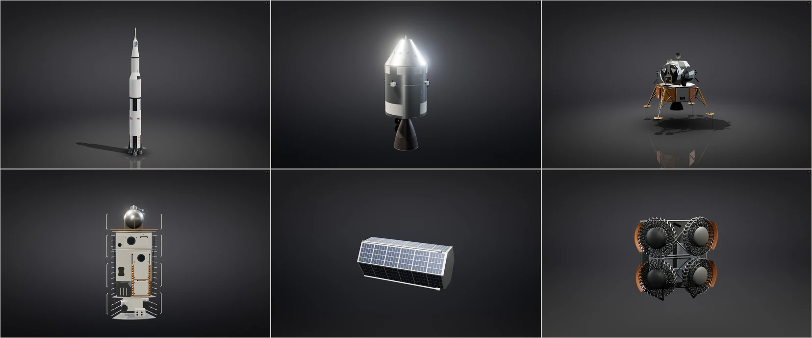

# Apollo 15 · Endeavour and Falcon

David Scott, Alfred Worden and James Irwin left Kennedy Space Center on 26 July 1971. Apollo 15 was the first J mission. Its longer stay at Hadley–Apennine needed a heavier lander and a vehicle that two astronauts could unpack on the surface. While Scott and Irwin drove three excursions, Worden mapped the Moon from Endeavour. [Apollo 15 Mission Report, §§1–4 and appendix A](https://apollojournals.org/alsj/a15/ap15mr.pdf)

In the Gallery, start at the bottom of **SA-510**. First-stage fairings A and C each carried a pair of retrorockets. The other two fairings were empty, and the second stage flew without ullage motors. These weight savings left a small margin between the stages as the second-stage engines started. Open adapter SLA-19 to see **Falcon** packed above the Saturn instrument unit with its landing gear folded. Switch to Falcon’s own plinth to see its extended gear and inspect the rover stowed in quadrant I of the descent stage. [AS-510 flight evaluation, §§2 and 10.6](https://ntrs.nasa.gov/citations/19730025086) · [Mission report, appendix A](https://apollojournals.org/alsj/a15/a15mr-a.htm)

Take Scott’s left couch, Worden’s centre couch or Irwin’s right couch inside **Endeavour**. Kennedy Launch Control recorded Scott boarding at 06:53 EDT and Irwin at 06:58, with Worden last. The Gallery approximates both hatch strokes and their closing times from the closeout calls. Outside the cabin, inspect the scientific instrument bay in the service module. Its door protected the cameras during launch and the outbound coast. The crew jettisoned the door before lunar orbit insertion, released a subsatellite before leaving lunar orbit, and brought the two camera film cassettes home after Worden retrieved them during a spacewalk. [Launch Control recording](https://www.apollojournals.org/afj/ap15fj/01launch_to_earth_orbit.html) · [NASA mission timeline](https://www.nasa.gov/wp-content/uploads/static/history/SP-4029/Apollo_15i_Timeline.htm)

In the **Lineup**, compare SA-510 with Apollo 14’s SA-509 at the same scale. Switch to spacecraft to bring Endeavour and Kitty Hawk down to eye level.

## Hardware notes

- [SA-510 and SLA-19](../../vehicles/sa-510.md)
- [CSM-112 Endeavour](../../vehicles/csm-112.md)
- [LM-10 Falcon](../../vehicles/lm-10.md)
