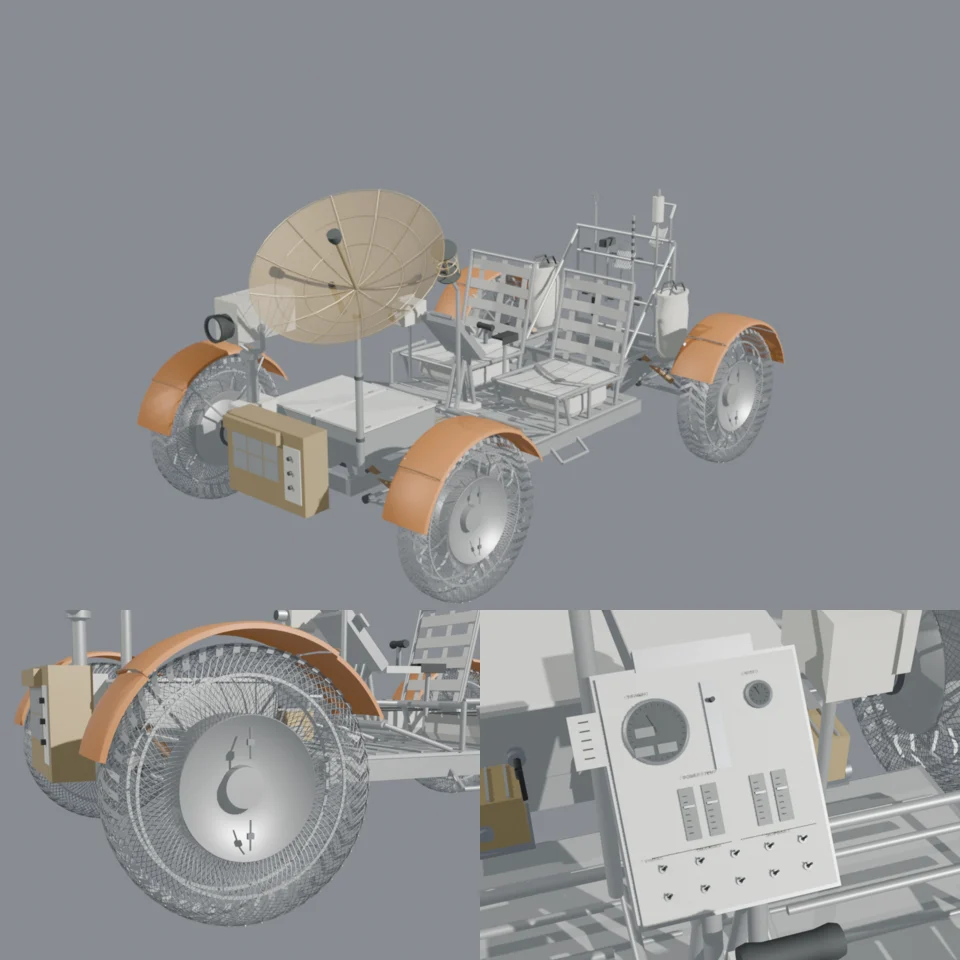
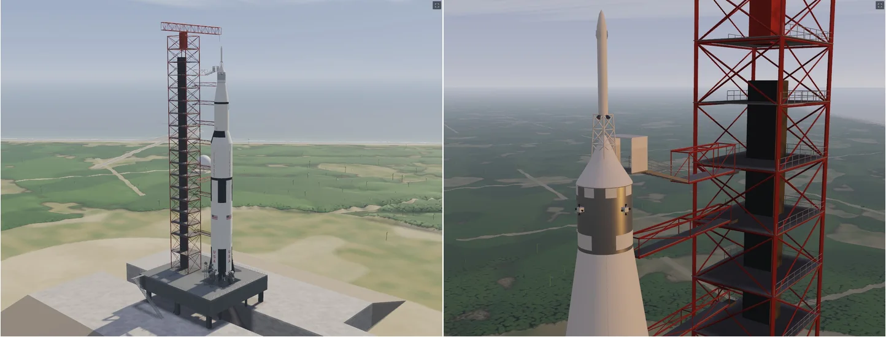

# Apollo 15 · Endeavour and Falcon

David Scott, Alfred Worden and James Irwin left Kennedy Space Center on 26 July 1971. Apollo 15 was the first J mission. Its longer stay at Hadley–Apennine needed a heavier lander and a vehicle that two astronauts could unpack on the surface. While Scott and Irwin drove three excursions, Worden mapped the Moon from Endeavour. [Apollo 15 Mission Report, §§1–4 and appendix A](https://apollojournals.org/alsj/a15/ap15mr.pdf)

In the Gallery, start at the bottom of **SA-510**. First-stage fairings A and C each carried a pair of retrorockets. The other two fairings were empty, and the second stage flew without ullage motors. These weight savings left a small margin between the stages as the second-stage engines started. Open adapter SLA-19 to see **Falcon** packed above the Saturn instrument unit with its landing gear folded. Switch to Falcon’s own plinth to see its extended gear and inspect the rover stowed in quadrant I of the descent stage. [AS-510 flight evaluation, §§2 and 10.6](https://ntrs.nasa.gov/citations/19730025086) · [Mission report, appendix A](https://apollojournals.org/alsj/a15/a15mr-a.htm)

Take Scott’s left couch, Worden’s centre couch or Irwin’s right couch inside **Endeavour**. Kennedy Launch Control recorded Scott boarding at 06:53 EDT and Irwin at 06:58, with Worden last. The Gallery approximates both hatch strokes and their closing times from the closeout calls. Outside the cabin, inspect the scientific instrument bay in the service module. Its door protected the cameras during launch and the outbound coast. The crew jettisoned the door before lunar orbit insertion, released a subsatellite before leaving lunar orbit, and brought the two camera film cassettes home after Worden retrieved them during a spacewalk. [Launch Control recording](https://www.apollojournals.org/afj/ap15fj/01launch_to_earth_orbit.html) · [NASA mission timeline](https://www.nasa.gov/wp-content/uploads/static/history/SP-4029/Apollo_15i_Timeline.htm)

In the **Lineup**, compare SA-510 with Apollo 14’s SA-509 at the same scale. Switch to spacecraft to bring Endeavour and Kitty Hawk down to eye level.

## Lunar rover · LRV-1

Open the [rover in the Gallery](https://jamesbrink.online/space-race/#usa/apollo/apollo-15/gallery/rover) to inspect the wire-mesh wheels, webbed seats and aft geology pallet. Choose **Drive rover** to join Scott and Irwin beside Falcon at Hadley–Apennine. Use WASD or the arrow keys to drive, Space to brake, C to switch between the driver’s seat and the chase camera, and Escape to park. On a touchscreen the controls accept steering and acceleration together.

The terrain follows LROC stereo elevations near the lander and LOLA altimetry beyond the stereo coverage. Sunlight is set to the start of the second excursion. The initial parking point, 12 m east of the lander, is estimated. Each wheel follows the surveyed ground. The driving model approximates steering and braking and omits soil deformation and wheel slip. [Rover hardware, sources and reconstruction limits](../../vehicles/lunar-rovers.md)

## Hardware notes

- [SA-510 and SLA-19](../../vehicles/sa-510.md)
- [CSM-112 Endeavour](../../vehicles/csm-112.md)
- [LM-10 Falcon](../../vehicles/lm-10.md)

## Launch site · Pad 39A

From the south approach, walk Scott, Worden or Irwin up the access stairs, ride the tower lift to the 320-foot level and cross arm 9 to Endeavour. Scott boarded at 06:53 EDT. At T−53 minutes Launch Control called for arm 9 to move to its 12° standby position. The animation allows an estimated 30 seconds for that stroke. Launch Control reported full retraction beginning near T−5 minutes. SA-510 first moved 0.30 seconds after range zero, followed by instrument-unit liftoff indication at +0.58 seconds. The three tail masts each use their own measured stroke duration. [Launch Control recording](https://www.apollojournals.org/afj/ap15fj/01launch_to_earth_orbit.html) · [AS-510 flight evaluation, tables 2-1 and 2-2 and §3.6.1](https://ntrs.nasa.gov/citations/19730025086)

The environmental control room, west of the launcher in the pad fill, supplied conditioned air and gaseous nitrogen. The changeover to nitrogen took place at 23:10 EDT on 25 July. The countdown team replaced a wet chiller solenoid valve and left its cover off so it could drain. The model shows the exterior and the air plenum. Equipment shapes and exterior fittings are estimates. [SA-510 flight manual, §VIII, fig. 8-10](https://www.apollojournals.org/afj/ap15fj/pdf/as15-sa510-flight-manual.pdf) · [AS-510 flight evaluation, §3.6.1](https://ntrs.nasa.gov/citations/19730025086)

At the 09:34 EDT launch the Sun stood 36.1° above the horizon at azimuth 85.8° true. The Moon was 12.1° below the horizon at azimuth 82.6°. The Cape reported seven tenths thin cirrus at 7,620 m and visibility of 16 km. The northwest light pole measured wind from 156° at 5.1 m/s. The simulation uses the measured wind at launch and ERA5 for the surrounding hours and the air aloft. The renderer estimates optical depth and spreads the cirrus over an 800 m band centred on the reported base. [AS-510 flight evaluation, appendix A and table A-1](https://ntrs.nasa.gov/citations/19730025086)

### Clearance against SA-510

The pad and vehicle collision tests sweep the nine combinations of model detail through boarding and arm withdrawal. The four hold-down shoes bear directly on the S-IC seats. The white-room deck clears the closed boost cover by at least 9.72 mm during the first 12° of travel in this reconstruction. This is a model-space clearance. The flight sources give the arm’s standby angle, but leave the deck recess dimensions unmeasured. [Dated launcher and reconstruction limits](../../../places/cape-canaveral/lc-39.md)

### Launch suits

Scott and Irwin wore the A7LB lunar configuration, with a diagonal entry zipper, larger wrist rings and six chest connections. Worden’s CMP garment had a rear entry and three chest connections. Scott’s red sleeve and leg bands identified the commander. The three walkers use the press kit statures of 6 ft, 5 ft 10½ in and 5 ft 8 in respectively. Their faces, garment contours, connector positions and ring sizes are reconstructed. The model omits insignia, ventilation hoses, portable ventilators and the internal mobility joints. [Mission report, appendix A.3.1](https://apollojournals.org/alsj/a15/a15mr-a.htm) · [Apollo 15 Press Kit, crew biographies](https://science.nasa.gov/wp-content/uploads/2023/09/Apollo_15-1.pdf) · [Scott’s suit](https://www.si.edu/object/pressure-suit-a7-lb-scott-apollo-15-flown%3Anasm_A19740189000) · [Worden’s suit](https://www.si.edu/object/pressure-suit-a7-lb-worden-apollo-15-flown%3Anasm_A19730059000) · [Irwin’s suit](https://www.si.edu/object/nasm_A19740132000)
