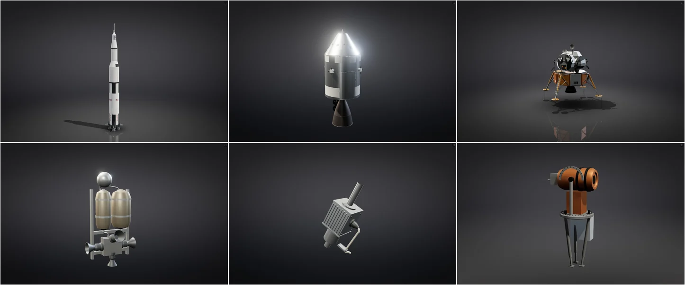
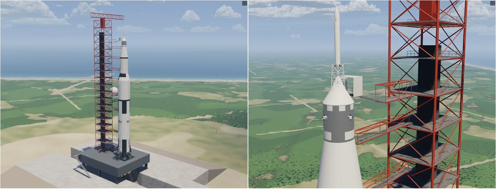

# Apollo 16 · Casper and Orion

John Young, Ken Mattingly and Charles Duke left Kennedy Space Center on 16 April 1972. Young and Duke were already aboard **Orion** in lunar orbit when a checkout of **Casper**’s service engine showed oscillations in its backup yaw control. The two spacecraft stayed close enough to rendezvous while engineers evaluated the fault. Cleared to proceed, Young and Duke landed in the Descartes highlands and spent three excursions exploring them. [Apollo 16 Mission Report, §§3–4 and 14](https://www.nasa.gov/wp-content/uploads/static/history/alsj/a16/A16_MissionReport.pdf)

In the **Gallery**, inspect the bottom of SA-511. Each of its four first-stage engine fairings carried a pair of retrorockets. Apollo 15 had flown with only four. Move the slider to see the spacecraft adapter open around Orion, then switch to the lander’s own plinth to see how far its landing gear extended. The rover travelled folded in quadrant I. On the opposite side, the crew carried a far-ultraviolet camera that they set up in Orion’s shadow to photograph Earth and the sky. [AS-511 flight evaluation, §10.6](https://ntrs.nasa.gov/citations/19730025090) · [Apollo 16 science planning document](https://www.lpi.usra.edu/lunar/ALSEP/pdf/ALSEP%20%23702%20-%20Mission%20Sci%20Plan%20Doc_Apollo%2016_040572.pdf)

Inside Casper, Young took the left couch, Mattingly the centre and Duke the right. The exhibit uses the press kit’s scheduled T−2:40 ingress. Hatch timings are estimated. Launch Control reported the cabin sealed at T−1:30:58 and the boost protective cover being installed at T−1:20:57. Outside the cabin, the scientific instrument bay carried two film cameras, instruments on retractable booms and a subsatellite. One boom stalled and was jettisoned before departure from lunar orbit. Mattingly retrieved the camera film during a spacewalk on the way home. [Launch-day crew account](https://www.nasa.gov/history/apollo-16-launches-to-the-moon/) · [Launch Control, tapes 1/1 and 2/1](https://www.nasa.gov/wp-content/uploads/2026/01/as16-pao.pdf) · [NASA mission timeline](https://www.nasa.gov/wp-content/uploads/static/history/SP-4029/Apollo_16i_Timeline.htm)

In the **Lineup**, compare SA-511 and SA-510 at the same scale. Switch to spacecraft to bring Casper and Endeavour down to eye level.

## Hardware notes

- [SA-511 and its spacecraft adapter](../../vehicles/sa-511.md)
- [CSM-113 Casper](../../vehicles/csm-113.md)
- [LM-11 Orion](../../vehicles/lm-11.md)

## Launch site · Pad 39A

SA-511 stood on Mobile Launcher 3. The stack had already made one trip back to the Vehicle Assembly Building for repairs. On launch day, the crew took the elevator to the 320-foot level. Young crossed the white room first, Duke followed, and Mattingly took the centre couch last. You can walk each route from the south approach and board Casper during the ingress window. The model starts boarding at the press kit’s scheduled T−2:40. [NASA’s rollback account](https://www.nasa.gov/history/50-years-ago-apollo-16-delayed-one-month-rolls-back-from-the-launch-pad/) · [Launch-day photographs and crew account](https://www.nasa.gov/history/apollo-16-launches-to-the-moon/)

Launch Control reported that arm 9 had reached its 12° standby position during the call between T−50:57 and T−49:55. At T−4:32 the announcer could see it swinging back to full retract. The model uses those observations to place the two strokes. Their endpoints are estimates. At the base, all four hold-down arms released pneumatically within 12 milliseconds of one another. The three tail service masts took 2.649, 2.292 and 2.505 seconds to retract after their umbilical plates separated. [Launch Control, tapes 6/1 and 16/1](https://www.nasa.gov/wp-content/uploads/2026/01/as16-pao.pdf) · [AS-511 flight evaluation, §3.5.1](https://ntrs.nasa.gov/citations/19730025090)

At the tower’s 200-foot level, look for the liquid-hydrogen purge console. Inspectors recorded a broken electrical terminal strip there after launch. The model shows the prelaunch cabinet with the strip intact. The report locates it on this level. The case dimensions, position on the floor and instrument layout are reconstructed. [AS-511 flight evaluation, §3.4.3](https://ntrs.nasa.gov/citations/19730025090)

At 12:54 EST the Sun was 70.3° above the horizon at azimuth 203.8° true. The Moon was 60.5° up, almost due east at 88.3°. The ground wind tower reported two tenths cumulus with bases at 914 m and 16 km visibility. The northwest pad pole measured 6.3 m/s from 269°. SA-511 climbed through clear air between the clouds. The model uses the observed sky and surface wind at launch, a reconstructed cloud depth and ERA5 for the surrounding hours and air aloft. [AS-511 flight evaluation, appendix A, table A-1 and figures A-3 and A-4](https://ntrs.nasa.gov/citations/19730025090)

### Clearance and boarding

The pad and rocket tests compare the exported surfaces in all nine combinations of detail. The collision tests check each arm and the structure around it throughout the countdown, a shoulder-width passage through the open hatch and the full fin span along the first 150 m of the cleared launch axis. During the first 12° of arm travel, the white-room deck clears Casper’s closed boost cover by at least 9.72 mm in the model. This bound includes the maximum travel between clearance samples. The recess dimensions are estimated. The four hold-down shoes support the vehicle at its bearing lugs. The mast carriers and retaining links withdraw from their mating fittings. [Dated launcher, equipment and reconstruction limits](../../../places/cape-canaveral/lc-39.md)

Young’s red bands distinguish the commander on the approach. He and Duke wear side-entry suits fitted for the lunar rover. Mattingly’s rear-entry suit has three chest connectors. The mission emblems follow launch-day photographs, and the three figures use the individual statures listed in the press kit. The emblem’s size and location on the garment are estimated. [Apollo 16 launch garments and references](../../crew/a7l.md#apollo-16-launch-garments)
