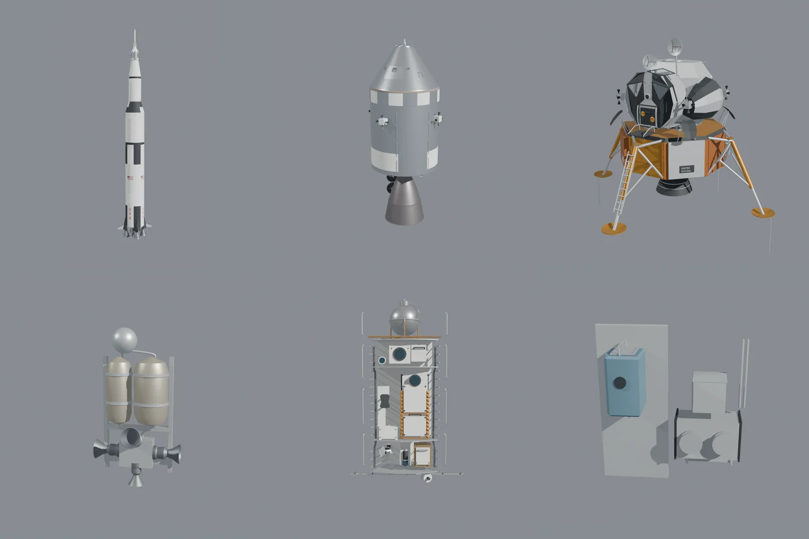
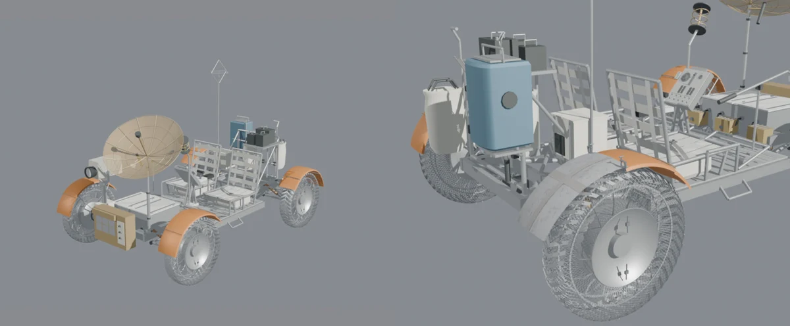

# Apollo 17 · America and Challenger

Eugene Cernan, Ronald Evans and Harrison Schmitt launched aboard Saturn V SA-512 at 05:33 UTC on 7 December 1972. Cernan and Schmitt landed Challenger in the Taurus–Littrow valley, where they made three excursions with LRV-3. Evans remained in lunar orbit with America. He went outside on the way home to retrieve the sounder, panoramic camera and mapping camera film. The flight lasted 301 hours, 51 minutes and 59 seconds. [NASA mission overview](https://www.nasa.gov/missions/apollo/apollo-17-mission-details/) · [Apollo 17 timeline](https://www.nasa.gov/wp-content/uploads/static/history/SP-4029/Apollo_17i_Timeline.htm)

## America and SA-512

Start in the [Gallery](https://jamesbrink.online/space-race/#usa/apollo/apollo-17/gallery) with the complete stack. Open SLA-21 to see Challenger folded beneath America's service engine. The S-IC carried eight retrorockets in four pairs. The auxiliary propulsion modules on S-IVB-512 helped orient the third stage after separation. In the [Lineup](https://jamesbrink.online/space-race/#lineup/usa/apollo/apollo-17/vs/usa/apollo/apollo-16), compare SA-512 with SA-511 or bring the command and service modules down to eye level. [AS-512 flight evaluation and flight documents](https://apollojournals.org/afj/ap17fj/a17-documents.html)

Take Cernan's left couch, Evans's centre couch or Schmitt's right couch. Open the scientific instrument module to inspect the coherent radar sounder and its optical recorder, the far-ultraviolet spectrometer and the infrared scanning radiometer. NASA's equipment drawing on p. 56b places each in its compartment. [Apollo 17 press kit](https://science.nasa.gov/wp-content/uploads/2023/09/Apollo_17.pdf)

## Challenger

The [Challenger exhibit](https://jamesbrink.online/space-race/#usa/apollo/apollo-17/gallery/challenger) opens with the landing legs extended and the surface equipment packed. Inspect the commander's and pilot's standing stations, the rover in quadrant I, the Array E science packages in quadrant II, and the traverse gravimeter and surface electrical properties equipment in quadrant III. The neutron probe travelled in two sections in the equipment assembly in quadrant IV. [Spacecraft Operational Data Book, appendix F §2.2 and figs. 2-1–2-4](https://www.lpi.usra.edu/lunar/ALSEP/pdf/31111000672962f.pdf)

## LRV-3 at Taurus–Littrow

Open the [rover](https://jamesbrink.online/space-race/#usa/apollo/apollo-17/gallery/rover) to see the tape and clamps on the four-map fender repair. Inspect the traverse gravimeter, the surface electrical properties receiver and its three-axis antenna. Schmitt photographed the rover shortly after the crew left Challenger on their second excursion. [Flight photographs AS17-135-20542 through 20544](https://www.apollojournals.org/alsj/a17/images17.html)

Choose **Drive rover** to take the wheel. WASD or the arrow keys drive and steer, Space brakes, C switches between the driver and chase cameras, and Escape parks. Touch controls allow simultaneous steering and acceleration. The light is set to 00:17:02 UTC on 13 December, when the crew departed for the surface electrical properties experiment. That is 138:44:02 after actual launch in mission report table 4-I. The rover starts an estimated 12 m east of the lander and carries both crew members in the driving view. [Mission report, table 4-I](https://apollojournals.org/alsj/a17/A17_MissionReport.pdf)

The driving surface uses a 2 m stereo strip around Challenger and the 5 m Taurus–Littrow mosaic across the valley. Beyond the stereo coverage, the horizon follows LOLA altimetry. The lander location comes from LROC and its west-facing orientation is estimated from the lunar window panoramas. The positions of individual stones and the ground beneath the footpads are reconstructed. The wheels follow the modeled surface with articulated suspension. Soil slip and tire deformation are simplified. [LROC terrain products](https://data.lroc.im-ldi.com/lroc/view_rdr/NAC_DTM_APOLLO17) · [LROC landing coordinates](https://lroc.im-ldi.com/data/support/downloads/2016_LROC_Coordinates_of_Human_Features.pdf)

## Hardware notes

- [SA-512 and SLA-21](../../vehicles/sa-512.md)
- [CSM-114 America](../../vehicles/csm-114.md)
- [LM-12 Challenger](../../vehicles/lm-12.md)
- [LRV-3](../../vehicles/lrv-3.md)
