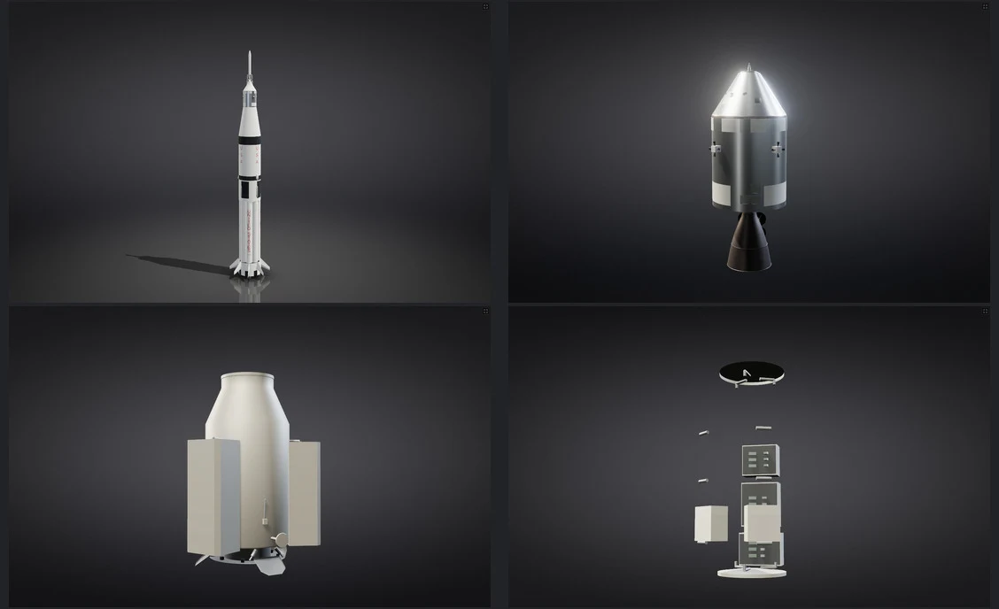

# Apollo–Soyuz · CSM-111 and SA-210

Tom Stafford, Vance Brand and Deke Slayton took off from Kennedy’s Pad 39B on 15 July 1975. Soyuz 19 had launched from Baikonur seven and a half hours earlier with Aleksey Leonov and Valeriy Kubasov. Two days later the two spacecraft met in low Earth orbit. This was the first crewed docking between spacecraft from different nations, and the final flight of both Apollo and the Saturn IB. [Apollo Soyuz Mission Evaluation Report, JSC-10607, §§2–3](https://ntrs.nasa.gov/citations/19760023154) · [NASA’s launch account](https://www.nasa.gov/history/45-years-ago-soyuz-and-apollo-launch/)

[Open the Apollo–Soyuz Gallery](https://jamesbrink.online/space-race/#usa/apollo/apollo-soyuz/gallery) or [compare SA-210 with SA-208 in the Lineup](https://jamesbrink.online/space-race/#lineup/usa/apollo/apollo-soyuz/vs/usa/skylab/skylab-4). The spacecraft row lets you inspect the Apollo hardware separately from the booster.

## The last Saturn IB

Mobile Launcher 1’s pedestal put the Saturn IB’s command module within reach of the same tower arms used by the taller Saturn V. Eight H-1 engines lifted the vehicle and a J-2 on the S-IVB inserted Apollo into a 148.9 by 168.2 km orbit inclined about 51.8°. CSM-111 came free of the S-IVB just over an hour later. SA-210 had already had all eight of its first-stage fins replaced after inspectors found stress-corrosion damage on two. Look through the assembled stack and move the slider to follow the stages and find the payload beneath the service engine. [JSC-10607, §3 and appendix A, fig. A-1](https://ntrs.nasa.gov/citations/19760023154) · [NASA SP-4209, appendix F](https://www.apolloexplorer.co.uk/books/sp-4209/appf.htm)

## Two interfaces and an airlock

Apollo’s ordinary probe and drogue connected CSM-111 to the new docking module. The pressurized module launched inside the spacecraft–launch vehicle adapter, where a lunar module would have ridden on a Moon flight. Stafford turned the spacecraft around, docked with the module and withdrew it from the adapter. At the other end, three guide petals helped align the compatible docking rings. The same interface could operate with either ship’s capture system active. Apollo was active on the first docking, Soyuz on the second. [JSC-10607, §§2–4 and A.1](https://ntrs.nasa.gov/citations/19760023154)

Apollo used pure oxygen in orbit at about 34 kPa. Soyuz used an oxygen–nitrogen mixture and lowered its cabin pressure to about 69 kPa for the joint phase. The new module allowed the crews to change pressure and gas composition between hatches as they passed between spacecraft in shirtsleeves. The handshake between Stafford and Leonov took place at the Soyuz end. After first undocking, Apollo moved between the Sun and Soyuz, making an artificial eclipse so the cosmonauts could photograph the solar corona. [JSC-10607, §§6.1.9, 8 and appendix A](https://ntrs.nasa.gov/citations/19760023154)

## CSM-111

Take Stafford’s left couch, Brand’s centre couch or Slayton’s right couch. Apollo carried four colour television cameras, two stowed in the command module and two in the docking module. A recorder aboard Apollo could capture their signals and those of an Apollo camera installed in Soyuz. The service module’s instrument bay housed a soft X-ray detector, an extreme ultraviolet telescope and a helium glow instrument. The docking module carried a different ultraviolet instrument. It sent light to retroreflectors on Soyuz to measure how much the upper atmosphere absorbed. CSM-111’s high-gain antenna and ATS-6 communications hardware helped carry pictures beyond the range of the conventional tracking stations. [JSC-10607, §§6.1.2–6.1.5, A.3 and A.4](https://ntrs.nasa.gov/citations/19760023154) · [NASA SP-4209, ch. XI, “Launch and First Day”](https://www.apolloexplorer.co.uk/books/sp-4209/ch11-1.htm)

CM-111 splashed down in the Pacific at 21:18:24 UTC on 24 July. The crew inhaled nitrogen tetroxide fumes from the command module’s thrusters during descent. They used oxygen masks and later received treatment aboard USS *New Orleans*. [JSC-10607, §§9.5, 11.3.4 and 14.1.2](https://ntrs.nasa.gov/citations/19760023154)

## Reading the figures

- The Gallery clock uses Apollo’s range zero at 19:50:00 UTC. The JSC report describes lift-off at 19:50:00.6 UTC, using instrument-unit umbilical disconnect as its telemetry reference. Its mission elapsed times start instead at Soyuz lift-off, 12:20 UTC. The Gallery’s timeline uses the report’s GMT column and subtracts Apollo range zero. [JSC-10607, §3.1 and tables 3-II and 3-IV](https://ntrs.nasa.gov/citations/19760023154)
- The quoted Saturn mass is the preflight estimate. The CSM and docking-module masses are the separate values at orbit insertion from the postflight report. The exact stack stations are assumed from the comparable Skylab Saturn IB drawing. NASA’s ASTP press kit lists 224 ft alongside an inconsistent 67 m. The exhibit uses the shared station drawing. [ASTP press kit, pp. 82–84](https://ntrs.nasa.gov/citations/19750015551) · [JSC-10607, table F-I](https://ntrs.nasa.gov/citations/19760023154) · [SA-206 flight manual, fig. 1-1](https://ntrs.nasa.gov/citations/19740021163)
