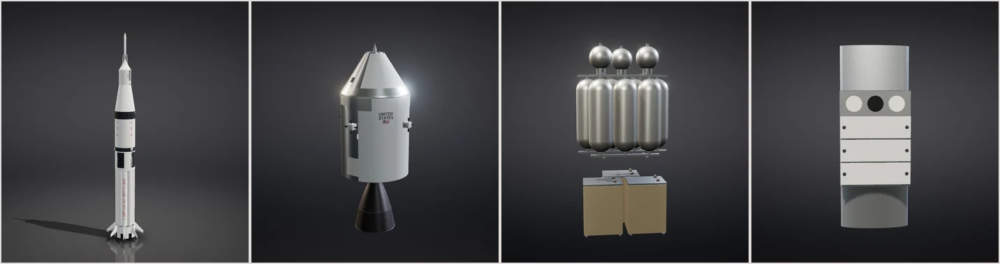
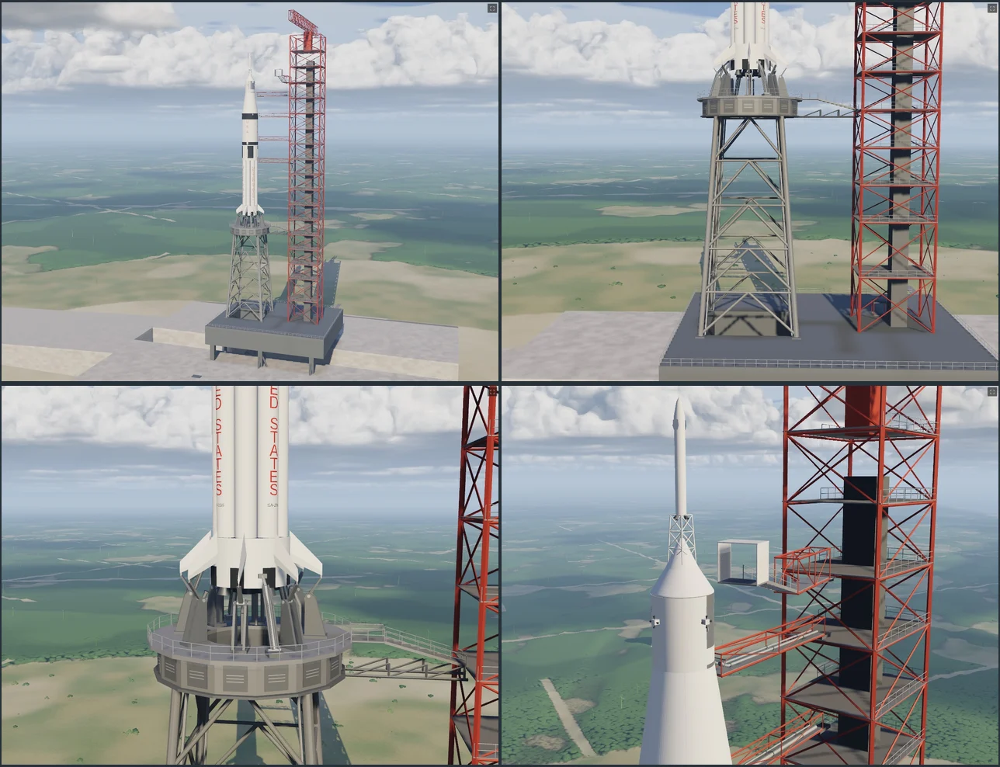

# Skylab 2 · CSM-116 on SA-206

At 09:00 EDT on 25 May 1973, Pete Conrad, Joseph Kerwin and Paul Weitz left Kennedy’s Pad 39B on a two-stage Saturn IB. Their destination was already in orbit. A Saturn V had launched Skylab eleven days earlier, but the workshop had lost its meteoroid shield and one solar wing during ascent. A strip of torn metal pinned the surviving wing against its side. NASA postponed the crew’s launch while engineers prepared three kinds of sunshade and the tools to work on the damaged station. [KSC launch record, pp. XI-1–XI-2](https://ntrs.nasa.gov/api/citations/19740015280/downloads/19740015280.pdf)

At range zero, the Sun stood 31.3° above the eastern horizon at azimuth 81.6° true. The Moon was to the southwest at elevation 50.1° and azimuth 214.2°. These are geometric directions from Pad 39B, calculated with the simulator’s JPL DE440 ephemeris.

## CSM-116 and SA-206

Open the [Gallery](https://jamesbrink.online/space-race/#usa/skylab/skylab-2/gallery) and compare the stacked vehicle with [Apollo 7 in the Lineup](https://jamesbrink.online/space-race/#lineup/usa/skylab/skylab-2/vs/usa/apollo/apollo-7). Both boosters clustered eight small tanks around a central oxygen tank. On SA-206 the outer fuel tanks were white. Look above the single J-2 engine for the instrument unit’s two M415 panels. Their 24 samples tested how thermal-control coatings fared when exposed at different phases of flight. The flight report records contamination of two samples when separation rockets fired. [SA-206 flight manual, figs. 1-1, 6-29 and 6-30](https://ntrs.nasa.gov/citations/19740021163) · [SA-206 flight evaluation, §18](https://ntrs.nasa.gov/citations/19730025087)

Open the service module to inspect the equipment that supported long stays at the station. Sector I carries extra reaction-control propellant. Descent batteries adapted from the lunar module provided electrical power, and a tank in the core collected surplus water from the fuel cells. The command and service modules had a sun-facing white coating for their long spell docked in one attitude. In the cabin, look through the hatch where Weitz stood with his repair tool while Conrad flew alongside the workshop. [Skylab CSM 116–118 Operations Handbook, vol. I, fig. 1-29 and §§2.5–2.8](https://ntrs.nasa.gov/citations/20160013589) · [NASA’s account of the first inspection](https://www.nasa.gov/history/50-years-ago-skylab-2-the-we-fix-anything-crew/)

Take Conrad’s left couch, Kerwin’s centre couch or Weitz’s right couch. The flight plan assigned those seats from launch through docking and again from undocking through splashdown. Under the couches, the folded parasol travelled in a canister only eight inches square in cross-section. [NASA Reference Skylab Flight Plan, Crew Scheduling A.1–2](https://www.ibiblio.org/apollo/Documents/46377138-Reference-Skylab-Flight-Plan-SL-1-SL-2-SL-3-And-SL-4-April-30-1973-SL-1-Launch.pdf) · [NASA’s account of the canister](https://www.nasa.gov/history/50-years-ago-skylab-2-the-we-fix-anything-crew/)

## Launch Complex 39B on 25 May 1973

[Walk the launch site](https://jamesbrink.online/space-race/#usa/skylab/skylab-2/site/pad) as Conrad, Kerwin or Weitz. Follow the approach to the launcher stairs, ride the tower elevator to level 320 and cross arm 9 into the white room. The model opens at scheduled ingress. The exact moment the pressure hatch closed is estimated. At 08:02 EDT Launch Control reported that the closeout team had secured the white room. The arm swung back to its twelve-degree standby position during the T−45 minute call, then withdrew fully in the final five minutes. [Launch commentary, tapes MC1/1, MC2/1, MC3/1 and MC9/1](https://digitalprojects.uah.edu/files/original/21/14413/sdsp_skyl_000078_001.pdf)

From tower level 120, look across the shorter bridge to the working deck of the Saturn IB pedestal. Beneath the eight fin supports are two floors with an exhaust opening through both. A fuel mast, an oxygen mast and two cable masts served the S-IB from this deck. Four inflight arms and the crew access arm occupied the tower. At launch the hold-downs released first, followed by first motion at 0.19 seconds. The service arms then pulled their carriers clear. [SA-206 Flight Manual, §VII, figs. 7-5 through 7-7](https://ntrs.nasa.gov/citations/19740021163) · [Flight evaluation, §§2, 3 and 10.2](https://ntrs.nasa.gov/citations/19730025087)

Broken cloud hung over the pad at liftoff. Observers reported fractocumulus at 244 m, altocumulus at 2,438 m and cirrus at 9,144 m, with nine tenths of the sky covered in total. The northwest pad light pole measured winds of 5.5 m/s from 212°. Individual cloud shapes, cloud drift and the changing sky between observations are reconstructed. [SA-206 flight evaluation, appendix A, table A-1](https://ntrs.nasa.gov/citations/19730025087)

## First visit

On 26 May the astronauts pushed a folded parasol through the scientific airlock and opened it over the bare workshop skin. As the workshop cooled, the crew could work inside for longer stretches. On 7 June Conrad and Kerwin went outside to release the trapped solar wing. It unfolded gradually in sunlight and supplied enough electricity to resume experiments. On 19 June Conrad and Weitz went outside again, this time to retrieve film from the Apollo Telescope Mount and change cameras. [NASA, Skylab chronology, entries for 26 May and 7 and 19 June](https://www.nasa.gov/wp-content/uploads/2023/04/sp-4011.pdf)

CSM-116 pulled away from the station at 08:55 UTC on 22 June. Four hours later the crew fired the service engine to leave orbit. The command module splashed down in the Pacific after 28 days, 49 minutes and 49 seconds. USS *Ticonderoga* lifted the capsule aboard with the astronauts still inside. [NASA mission chronology, pp. 151–152](https://www.nasa.gov/wp-content/uploads/2023/04/1973.pdf) · [Historical Data Book, vol. III, table 2-49](https://ntrs.nasa.gov/citations/19880016046)

## Sources and reconstruction limits

- [Launch pressure garments](../../crew/a7lb.md) identifies the suit fittings, insignia and crew-specific proportions used on the approach and tower.
- [Saturn IB SA-206 and SLA-23](../../vehicles/sa-206.md) records the drawings, markings and gaps in the reconstruction of the launch vehicle.
- [Apollo CSM-116](../../vehicles/csm-116.md) distinguishes Skylab equipment from shared Block II geometry. The solar-coating boundary and placement of fittings inside the service bays are approximate.
- The flight record uses range zero at 13:00:00 UTC. SA-206 first moved 0.19 seconds later. The booster consumed propellant between ground ignition and first motion. Table 16-5 separately records the mass removed from the upper stage at spacecraft separation, 13,978 kg for CSM-116. [SA-206 flight evaluation, §2 and tables 4-3 and 16-1](https://ntrs.nasa.gov/citations/19730025087)
- The NASA chronologies give different parasol times. The Gallery uses the 17:00–19:30 EDT deployment in the 26 May entry of SP-4011, drawn from the first-visit mission report. Crew events reported to the minute retain that precision. [Skylab chronology](https://www.nasa.gov/wp-content/uploads/2023/04/sp-4011.pdf) · [Astronautics and Aeronautics, 1973, p. 148](https://www.nasa.gov/wp-content/uploads/2023/04/1973.pdf)
