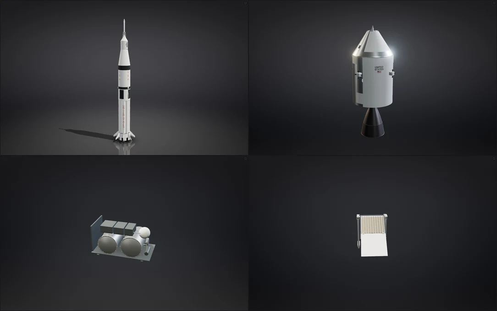

# Skylab 3 · CSM-117 on SA-207

At 07:10 EDT on 28 July 1973, Alan Bean, Owen Garriott and Jack Lousma left Kennedy’s Pad 39B for the second crew visit to Skylab. The first crew had freed a jammed solar wing and shaded the damaged workshop with a parasol. They had also left a folded twin-pole shade aboard. The second crew would assemble it outside and spread it over the parasol. [NASA, Skylab 3 launch and rendezvous](https://www.nasa.gov/history/50-years-ago-second-skylab-crew-begins-record-breaking-mission/) · [Second Visit Mission Report, §§2–3](https://ntrs.nasa.gov/citations/19740011377)

At range zero the Sun stood just 5.2° above the horizon at azimuth 71.2° true. The Moon stood higher in the same part of the sky, at elevation 21.8° and azimuth 77.0°. The simulator calculates these geometric directions from Pad 39B with the JPL DE440 ephemeris.

## The launch vehicle as an observatory

Open the [Gallery](https://jamesbrink.online/space-race/#usa/skylab/skylab-3/gallery) or [stand SA-207 beside SA-206 in the Lineup](https://jamesbrink.online/space-race/#lineup/usa/skylab/skylab-3/vs/usa/skylab/skylab-2). Look inside the instrument unit beneath the four adapter panels. SA-207 carried a gas-filled X-ray detector, a supply of argon and methane, star sensors and a recorder. After CSM-117 pulled away, the instrument could swing out and look through the open end of the adapter. The spent upper stage turned to point it at the sky. Falling gas pressure switched off the counter after 110 minutes of measurements. The star sensors kept tracking. [SA-207 flight evaluation, §18](https://ntrs.nasa.gov/citations/19730025088)

## The station ferry

Take Bean’s left couch, Garriott’s centre couch or Lousma’s right couch. During rendezvous the crew used a handheld HP-35 calculator to find their closing speed. On the right side of the spacecraft, what the crew described as snow outside the window gave them the first sign that one of the four thruster clusters was losing oxidizer. They isolated quad B and reached Skylab on the fifth orbit. A second cluster, quad D, developed a leak while the spacecraft was docked. NASA began preparations for a possible rescue while engineers worked through the return maneuvers on the two remaining clusters. [Reference Skylab Flight Plan, Crew Scheduling A.1–2](https://www.ibiblio.org/apollo/Documents/46377138-Reference-Skylab-Flight-Plan-SL-1-SL-2-SL-3-And-SL-4-April-30-1973-SL-1-Launch.pdf) · [NASA’s rendezvous account](https://www.nasa.gov/history/50-years-ago-second-skylab-crew-begins-record-breaking-mission/) · [Second Visit Mission Report, §§7.7, 17.1](https://ntrs.nasa.gov/citations/19740011377)

## Second visit

On 6 August Garriott and Lousma assembled the two long poles and spread the new shade above the workshop. On their next spacewalk they ran a cable outside to connect six replacement rate gyros mounted inside the station. Bean and Garriott made the final spacewalk on 22 September to bring in exposed film and experiment samples. [Second Visit Mission Report, §§3 and 10](https://ntrs.nasa.gov/citations/19740011377) · [NASA’s account of the second crew’s spacewalks](https://www.nasa.gov/history/skylab-3-spacewalks-and-science/)

CSM-117 left the station on 25 September. Quads A and C controlled the spacecraft through a single service-engine burn to leave orbit. CM-117 splashed down in the Pacific at 22:19:54 UTC after 59 days, 11 hours, 9 minutes and 4 seconds. It initially floated nose down. Flotation bags righted it, and USS *New Orleans* lifted the capsule aboard with all three astronauts inside. [Second Visit Mission Report, §§2, 7.7, 12 and 13](https://ntrs.nasa.gov/citations/19740011377)

## Sources and reconstruction limits

- [Saturn IB SA-207 and its X-ray experiment](../../vehicles/sa-207.md) records the evidence for the flight hardware and its presentation. The overall stack stations come from the SA-206 flight manual. The ascent record uses SA-207’s own flight evaluation.
- [CSM-117](../../vehicles/csm-117.md) records the shared Skylab Apollo geometry and the reconstruction of flight-specific cabin equipment. The three seats follow the assignments in the flight plan.
- The mission clock starts at the flight evaluation’s range zero, 11:10:50 UTC. It distinguishes the first motion recorded to tenths of a second from instrument-unit disconnect sensed at +0.48 s. The orbital insertion figures use the launch-vehicle team’s reconstructed orbit. The CSM mass is the 14,167 kg removed from the stage’s mass ledger at spacecraft separation. [SA-207 flight evaluation, §§2 and 4, table 16-5](https://ntrs.nasa.gov/citations/19730025088)
