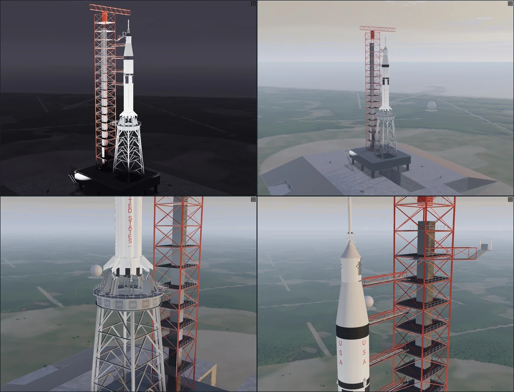

# Skylab 3 · CSM-117 on SA-207

At 07:10 EDT on 28 July 1973, Alan Bean, Owen Garriott and Jack Lousma left Kennedy’s Pad 39B for the second crew visit to Skylab. The first crew had freed a jammed solar wing and shaded the damaged workshop with a parasol. They had also left a folded twin-pole shade aboard. The second crew would assemble it outside and spread it over the parasol. [NASA, Skylab 3 launch and rendezvous](https://www.nasa.gov/history/50-years-ago-second-skylab-crew-begins-record-breaking-mission/) · [Second Visit Mission Report, §§2–3](https://ntrs.nasa.gov/citations/19740011377)

At range zero the Sun stood just 5.2° above the horizon at azimuth 71.2° true. The Moon stood higher in the same part of the sky, at elevation 21.8° and azimuth 77.0°. The simulator calculates these geometric directions from Pad 39B with the JPL DE440 ephemeris.

## Skylab as they found it

In the [Gallery](https://jamesbrink.online/space-race/#usa/skylab/skylab-3/gallery), choose *Skylab workshop* to see the station as the crew docked to it: the orange parasol over the bare gold wall and the workshop's one solar wing unfolded beside it. On their first spacewalk, on 6 August, Garriott and Lousma assembled two 55-foot poles on the solar observatory and hoisted the twin-pole sail over the parasol; Skylab 4's exhibit shows it there. [MSFC Skylab Mission Report, Saturn Workshop, §10.4](https://ntrs.nasa.gov/citations/19750002066) · [The workshop model](../../vehicles/workshop.md)

## Launch Complex 39B

Approach the mobile launcher from the south ramp, take the tower elevator to level 320, and cross the white room to CSM-117. Bean boards the left couch, Garriott the centre and Lousma the right. The same 127-foot steel pedestal that supported SA-206 carried SA-207. The crawler delivered this stack to Pad B on June 11. [Visit the launch site](https://jamesbrink.online/space-race/#usa/skylab/skylab-3/site/pad) · [SA-207 flight evaluation, table 3-1](https://ntrs.nasa.gov/citations/19730025088)

The site opens before dawn at scheduled crew ingress. Pad floodlights illuminate SA-207 as they did in a photograph taken eight nights earlier. Their use on launch morning is assumed and their layout is estimated. [NASA photograph S73-32568](https://www.nasa.gov/gallery/skylab-3/)

Launch Control reported the boost-cover hatch closed by countdown T−67 minutes, the access arm starting toward twelve-degree standby at T−45, and its final withdrawal at T−5. The site clock includes the two-minute hold at T−15. Pressure-hatch closeout and individual stroke durations are reconstructed. [Skylab 3 launch commentary, MC1, MC3, MC6 and MC8](https://digitalprojects.uah.edu/items/show/14424) · [Skylab 3 press kit, p. 20](https://ntrs.nasa.gov/citations/19760066714)

During oxygen replenishment, cameras caught intermittent discharges from the outboard first-stage tanks. Reviewers counted about forty from tanks 3 and 4 in half an hour of film. Vent closure came at T−2 minutes 43 seconds. The exhibit describes these discharges; their individual plumes are omitted. [SA-207 flight evaluation, §3.4.2.1 and fig. 3-1](https://ntrs.nasa.gov/citations/19730025088)

At liftoff, patchy ground fog limited reported visibility to 4.8 km. The observer recorded nine-tenths altocumulus at 4,570 m and five-tenths cirrus at 6,400 m. The northwest pad pole measured 2.6 m/s from 264° at 18.3 m above grade. The scene uses these observations with an estimated vertical fog profile and ERA5 winds aloft. [SA-207 flight evaluation, appendix A](https://ntrs.nasa.gov/citations/19730025088)

## The launch vehicle as an observatory

Open the [Gallery](https://jamesbrink.online/space-race/#usa/skylab/skylab-3/gallery) or [stand SA-207 beside SA-206 in the Lineup](https://jamesbrink.online/space-race/#lineup/usa/skylab/skylab-3/vs/usa/skylab/skylab-2). Look inside the instrument unit beneath the four adapter panels. SA-207 carried a gas-filled X-ray detector, a supply of argon and methane, star sensors and a recorder. After CSM-117 pulled away, the instrument could swing out and look through the open end of the adapter. The spent upper stage turned to point it at the sky. Falling gas pressure switched off the counter after 110 minutes of measurements. The star sensors kept tracking. [SA-207 flight evaluation, §18](https://ntrs.nasa.gov/citations/19730025088)

## The station ferry

Take Bean’s left couch, Garriott’s centre couch or Lousma’s right couch. During rendezvous the crew used a handheld HP-35 calculator to find their closing speed. On the right side of the spacecraft, what the crew described as snow outside the window gave them the first sign that one of the four thruster clusters was losing oxidizer. They isolated quad B and reached Skylab on the fifth orbit. A second cluster, quad D, developed a leak while the spacecraft was docked. NASA began preparations for a possible rescue while engineers worked through the return maneuvers on the two remaining clusters. [Reference Skylab Flight Plan, Crew Scheduling A.1–2](https://www.ibiblio.org/apollo/Documents/46377138-Reference-Skylab-Flight-Plan-SL-1-SL-2-SL-3-And-SL-4-April-30-1973-SL-1-Launch.pdf) · [NASA’s rendezvous account](https://www.nasa.gov/history/50-years-ago-second-skylab-crew-begins-record-breaking-mission/) · [Second Visit Mission Report, §§7.7, 17.1](https://ntrs.nasa.gov/citations/19740011377)

## Second visit

On 6 August Garriott and Lousma assembled the two long poles and spread the new shade above the workshop. On their next spacewalk they ran a cable outside to connect six replacement rate gyros mounted inside the station. Bean and Garriott made the final spacewalk on 22 September to bring in exposed film and experiment samples. [Second Visit Mission Report, §§3 and 10](https://ntrs.nasa.gov/citations/19740011377) · [NASA’s account of the second crew’s spacewalks](https://www.nasa.gov/history/skylab-3-spacewalks-and-science/)

CSM-117 left the station on 25 September. Quads A and C controlled the spacecraft through a single service-engine burn to leave orbit. CM-117 splashed down in the Pacific at 22:19:54 UTC after 59 days, 11 hours, 9 minutes and 4 seconds. It initially floated nose down. Flotation bags righted it, and USS *New Orleans* lifted the capsule aboard with all three astronauts inside. [Second Visit Mission Report, §§2, 7.7, 12 and 13](https://ntrs.nasa.gov/citations/19740011377)

## Sources and reconstruction limits

- [Saturn IB SA-207 and its X-ray experiment](../../vehicles/sa-207.md) records the evidence for the flight hardware and its presentation. The overall stack stations come from the SA-206 flight manual. The ascent record uses SA-207’s own flight evaluation.
- [CSM-117](../../vehicles/csm-117.md) records the shared Skylab Apollo geometry and the reconstruction of flight-specific cabin equipment. The three seats follow the assignments in the flight plan.
- The mission clock starts at the flight evaluation’s range zero, 11:10:50 UTC. It distinguishes the first motion recorded to tenths of a second from instrument-unit disconnect sensed at +0.48 s. The orbital insertion figures use the launch-vehicle team’s reconstructed orbit. The CSM mass is the 14,167 kg removed from the stage’s mass ledger at spacecraft separation. [SA-207 flight evaluation, §§2 and 4, table 16-5](https://ntrs.nasa.gov/citations/19730025088)
