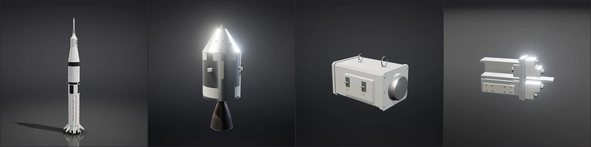

# Skylab 4 · CSM-118 on SA-208

Gerald Carr, Edward Gibson and William Pogue left Kennedy’s Pad 39B at 09:01 EST on 16 November 1973. Their spacecraft had already stood on that pad as a potential rescue ship for the preceding crew. It now carried the last three people to visit Skylab, with enough extra food and equipment for the option of an 84-day expedition. [NASA’s launch and rendezvous account](https://www.nasa.gov/history/50-years-ago-launch-of-skylab-4-the-final-mission-to-skylab/) · [Third Visit Mission Report, §§2 and 6.9](https://ntrs.nasa.gov/citations/19740027126)

At range zero, the Sun was in the southeast at azimuth 130.9° true and elevation 24.7°. The Moon was visible in the west at azimuth 261.1° and elevation 41.3°. These are geometric directions from Pad 39B computed with the simulator’s JPL DE440 ephemeris.

## Eight replacement fins

Open the [Gallery](https://jamesbrink.online/space-race/#usa/skylab/skylab-4/gallery) or [compare SA-208 with SA-207 in the Lineup](https://jamesbrink.online/space-race/#lineup/usa/skylab/skylab-4/vs/usa/skylab/skylab-3). Look around the base of the first stage. In November, workers tracing small cracks in the fin fittings found stress corrosion. They changed all eight fins with the rocket still on its launcher. At position four, the crew also spliced a damaged outrigger beam. Select that attachment to see the reinforcement at the joint. Above them, S-IVB-208 and instrument unit S-IU-207 delivered the crew to a 150.10 by 227.08 km orbit. Four panels on adapter SLA-24 opened to release CSM-118, eighteen minutes after launch. [SA-208 flight evaluation, §§3, 4 and 8.3.2](https://ntrs.nasa.gov/citations/19750002068) · [Skylab: A Chronology, p. 338](https://www.nasa.gov/wp-content/uploads/2023/04/sp-4011.pdf)

## What CSM-118 brought up

Take Carr’s left couch, Gibson’s centre couch or Pogue’s right couch. Open the cutaway and look behind the couches at the parcels above the aft lockers. Their contents included food for the long visit, replacement telescope film, a bracket for comet observations, coolant servicing accessories and a tool kit to repair the station’s Earth-observing microwave antenna. The stowage diagrams locate these items in the cabin. The shapes of the wrapped packages and their straps are estimated. [Third Visit Mission Report, §6.9 and fig. 6-4](https://ntrs.nasa.gov/citations/19740027126) · [Reference Skylab Flight Plan, Crew Scheduling A.1–2](https://www.ibiblio.org/apollo/Documents/46377138-Reference-Skylab-Flight-Plan-SL-1-SL-2-SL-3-And-SL-4-April-30-1973-SL-1-Launch.pdf)

Look for the double-ring sight on the S201 camera. This was the backup for the ultraviolet camera taken to the Moon on Apollo 16. For Skylab its optics, power supply and sequencer went into a vacuum-tight canister. The crew could aim it from the station’s scientific airlock or attach it to the telescope truss outside. Its photographs revealed the hydrogen halo around Kohoutek. [Third Visit Mission Report, §3.2.3 and appendix A.5](https://ntrs.nasa.gov/citations/19740027126)

## Third visit

Carr docked on the third attempt, about eight hours after launch. The crew slept in the command module and opened the station the following morning. One of their first jobs was to replenish the airlock’s primary coolant loop. Outside on Thanksgiving Day, Gibson held Pogue in position while Pogue rewired the antenna that the preceding crew had left jammed. [Third Visit Mission Report, §2](https://ntrs.nasa.gov/citations/19740027126) · [Astronautics and Aeronautics, 1973, pp. 320–321](https://www.nasa.gov/wp-content/uploads/2023/04/1973.pdf)

Two more spacewalks bracketed Comet Kohoutek’s passage around the Sun. Carr and Pogue took cameras outside on Christmas Day, then Carr and Gibson photographed the comet on 29 December as it receded. On 3 February the astronauts went out for the last time to bring in telescope film and exposed samples. [Third Visit Mission Report, §2](https://ntrs.nasa.gov/citations/19740027126)

On 8 February 1974 Carr flew CSM-118 around Skylab so the crew could photograph the station they were leaving. During entry preparations a suspected propellant leak led controllers to disable one of the two command-module reaction-control systems. CM-118 splashed down at 15:16:54 UTC after 84 days, 1 hour, 15 minutes and 31 seconds. The capsule floated nose down until its flotation bags righted it. The crew stayed aboard while USS *New Orleans* lifted it from the Pacific. [Third Visit Mission Report, §§2 and 11](https://ntrs.nasa.gov/citations/19740027126) · [NASA’s recovery account](https://www.nasa.gov/history/50-years-ago-skylab-4-astronauts-return-from-record-breaking-spaceflight/)

## Sources and reconstruction limits

- [SA-208](../../vehicles/sa-208.md) describes the flight hardware and which dimensions come from the SA-206 drawings. The model shows the first stage as it flew with its replacement fins.
- [CSM-118](../../vehicles/csm-118.md) describes the shared Block II geometry and the cabin’s third-visit equipment. The seat arrangement follows the programme flight plan. NASA’s recovery account confirms Gibson returned in the centre seat.
- The countdown entry for crew ingress uses the published schedule, including the two-minute hold at countdown T−15. The launch-vehicle figures use measured range time from 14:01:23 UTC. First motion occurred at +0.271 s, instrument-unit disconnect at +0.471 s. The separation mass is the 14,916 kg of CSM removed from the upper-stage mass ledger. [Skylab 4 press kit, p. 31](https://www.scribd.com/document/17113950/NASA-Skylab-4-Press-Kit) · [SA-208 flight evaluation, §§2–4 and table 16-5](https://ntrs.nasa.gov/citations/19750002068)
- The mission clock follows the Johnson Space Center report’s landing time, which agrees with its stated flight duration. Marshall’s programme summary gives the end of the mission one second later, at 15:16:55 UTC. [Third Visit Mission Report, §2](https://ntrs.nasa.gov/citations/19740027126) · [Marshall mission report, p. 63](https://ntrs.nasa.gov/citations/19740020204)
