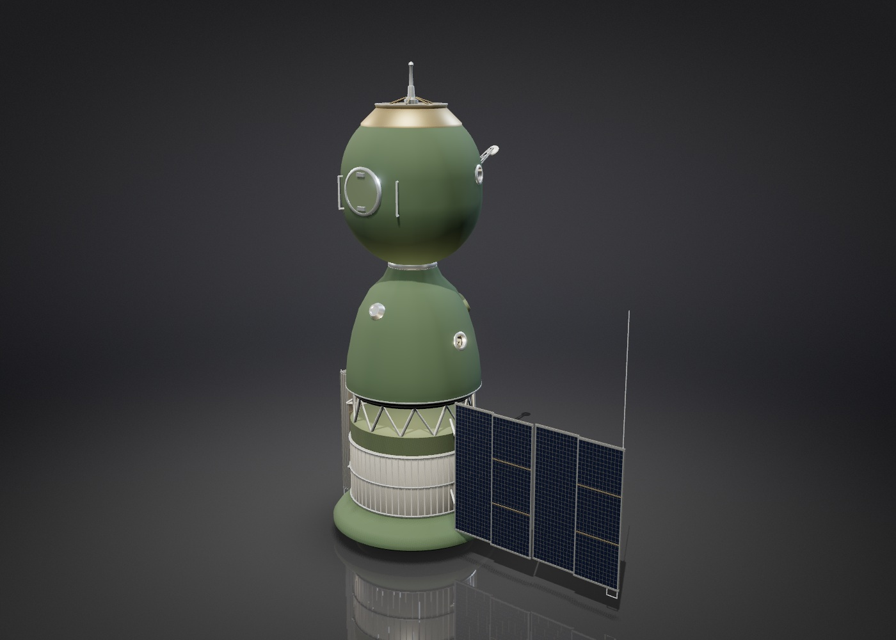

# Soyuz 1

**23–24 April 1967 · Vladimir Mikhailovich Komarov · Rubin (Рубин, “ruby”) · Soyuz 7K-OK No. 4 · Soyuz 11A511 · Tyuratam, Site 1**

Komarov flew the first crewed Soyuz. He was to dock with a second Soyuz and bring two of its
cosmonauts home. The two ships had no passage through the docking mechanism. The visitors would
have transferred by spacewalk, using the side hatches of the orbital modules. Soyuz 1’s left solar
wing stayed folded after separation. Problems with power and spacecraft orientation led the
commission to cancel the second launch and bring Komarov down early.

An automatic sequence inhibited the first planned braking burn. Komarov subsequently aligned the
ship by hand, and reported that the braking engine ran for 146 seconds. The descent module came
through a ballistic entry. Its drogue could not pull the main parachute out of its container, and
the reserve, caught in the drogue's shadow, did not fill. Komarov was killed when the descent module
struck the ground near Karabulak, 65 km east of Orsk, at 06:22:52 Moscow time. The commission’s
explanation for why the main stayed packed and Chertok’s later account differ. [Challenge to Apollo, pp. 581–589](https://www.nasa.gov/wp-content/uploads/static/history/SP-4408pt2.pdf) · [Siddiqi, “Fifty years later: Soyuz-1 revisited (part 2)”](https://www.thespacereview.com/article/3229/1) · [RKK Energia history, ch. 5](https://testpilot.ru/espace/bibl/energia-50/05.php)

## The flight as flown

From [mission.md](mission.md). The ascent is flown on the 11A511's own figures and, no instant of this vehicle's having been
found, Soyuz 3's vehicle's instants: Block I is cut on the orbit at 531 s with 102 kg left, level at 200.9 km. The
correction of the fifth orbit is flown against the motion (the middle of Mishin's 3.1 to 3.8 m/s), and the braking burn
of the nineteenth orbit, 143.5 s, tail first, timed for the landing place. The entry is ballistic, as the record has it:
no bank is held and the module's lift is never flown, at most 8.4 g. The parachute system starts at 7 km; the drogue comes
out; **the main stays in its container**; the reserve comes out at 2 km in the drogue's shadow and does not fill. The
descent module strikes the ground at **36.4 m/s**, 190 s before the record's instant and 32 km across the track from its
point. Komarov is killed.

The sources disagree on that speed: Kamanin's report from the site that day has 35 to 40 m/s (the check's figure); Siddiqi
40; Afanasyev and Vorontsov "over 50"; the flight surgeons Bychkov and Artamoshin, as Zak gives them, 26 to 30. The run's
36.4 is not fitted: it rests on two estimates, the height the reserve came out at and what of its drag a fouled canopy keeps
(mission.md). On the drogue alone the module would have fallen at 58 m/s.

On the flight deck the faults are the hardware's, whatever the hands do: the main stays in its container when it is given,
and the reserve, whenever it comes out with the drogue still out, does not fill. Nothing aboard could let the drogue go (an
emergency release for it was fitted after this flight), and no source read gives the crew a command of their own for the
reserve: the system put it out on its own speed check. The deck's action gives the descent's steps in their order, as the
sequence would, so the reserve comes after the drogue and fouls on it as on the day; no part's menu offers it.

What the run does not do:

- The folded wing changes nothing flown: the simulator has no electricity and no attitude in orbit. What it cost is in the
  record: the ship's life on its batteries (some 23 orbits) and the entry flown ballistic.
- The failed attempts at the braking burn on the 17th orbit, the attempts to spin the ship to the Sun and the orientation by
  hand are told, not flown.
- The correction is flown on the main engine alone.
- The fire after the impact and the wreck are not shown.

## Gallery

The assembled exhibit shows the 11A511 at 49.913 m tall, using the overall dimension in RKK
Energia’s cutaway. The slider lifts the escape tower, opens the fairing and separates the stages
and spacecraft modules for inspection. The Spacecraft choice displays the instrument and propulsion
module, descent module and orbital module together at floor level. The right solar wing opens
on the slider, and the left stays folded as it did in orbit.

The spacecraft is an early 7K-OK with an active docking probe. The body is 6.98 m long and the
model is 7.6 m with the probe. This is an estimated reconciliation of published, rounded lengths
whose reference stations are unspecified. [Gagarin Cosmonaut Training Center](https://www.gctc.ru/main.php?id=299) · [RKK Energia history, 1946–1996](https://testpilot.ru/espace/bibl/energia-50/05.php)

The cabin cutaway and Komarov’s couch are reconstructed
from period material. The gallery’s separation and solar-wing motions are illustrative.

The Gallery uses studio light.

## Liftoff and orbit

Soyuz 1 lifted off at 03:35 Moscow time (00:35 UTC) from [Site 1](../../../places/tyuratam/site-1.md).
The same site coordinates and world ephemeris used by the earlier flights give the Sun at azimuth
68.9°, elevation −3.0°, and the Moon at azimuth 269.3°, elevation −3.6°, waxing and about 97%
illuminated. The elevation figures are geometric.

Siddiqi lists the mass as 6,450 kg and the flight as 18 orbits in his orbital-flight table. [Challenge to Apollo, appendix, Table I](https://www.nasa.gov/wp-content/uploads/static/history/SP-4408pt2.pdf)

The contemporary TASS report gives a preliminary orbit of 201 × 224 km, an inclination of
51°40′ and a period of 88.6 minutes. The orbital transcript instead records 209 × 224.1 km and
88.62 minutes as radioed by ground control. The exhibit identifies its figures as the preliminary
publication. [TASS communiqué, NASA translation ST-PR-10595, p. 1](https://ntrs.nasa.gov/api/citations/19670017082/downloads/19670017082.pdf) · [Flight communications transcript, p. 32](https://imwerden.de/pdf/istorichesky_archiv_2002_2__ocr.pdf)

## Gallery screenshots

[Assembled launch vehicle](../../../../../docs/readme/soyuz-1/launcher.jpg) · [Three spacecraft modules separated](../../../../../docs/readme/soyuz-1/separation.jpg) · [Komarov in the descent cabin](../../../../../docs/readme/soyuz-1/descent-cabin.jpg) · [The Sirius-7K console from the centre couch](../../../../../docs/readme/soyuz-1/sirius.jpg)

## Launch site

The launcher hangs above the Site 1 flame pit between the paired Soyuz service towers. Advance the pad slider to lower the towers. The opening time and clearance interval are illustrative. The sky is the day's: no report from the range has been read, and Kazalinsk, 97 km west, had the whole sky under altocumulus and a near calm at 00:00 UTC, 35 minutes before the night launch ([weather.ts](weather.ts); NOAA ISD); ERA5 supplies the surrounding hours and the air aloft. [Pad model, sources and simplifications](../../../places/tyuratam/site-1.md#soyuz-crews-at-site-1-19671980)

Walk as Komarov in the light flight clothing reconstructed for the cabin. The model uses his existing standing figure. Each walk starts on the rail apron facing the launcher. The starting positions, footwear and garment details are reconstructed.
