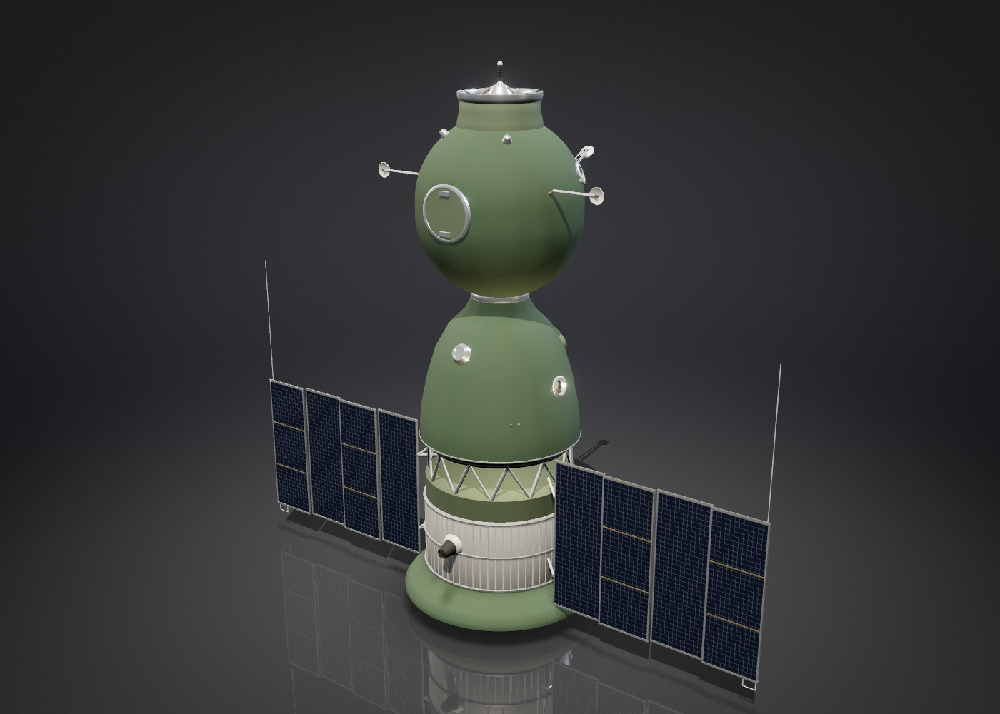

# Soyuz 10

**22–24 April 1971 UTC · Vladimir Shatalov, Aleksey Yeliseyev and Nikolay Rukavishnikov · Granit (Гранит) · Soyuz 7K-OKS No. 31 · Soyuz 11A511 · Tyuratam, Site 1**

Soyuz 10 carried the first crew sent to Salyut 1, the world's first space station, which had
launched on 19 April. The crew was to spend about a month on the station. No. 31 introduced a
probe-and-drogue joint with a hatch through its centre, so a crew could cross inside a sealed
passage. The probe caught Salyut 1, but the collars never came together. The three cosmonauts
returned without entering the station. [NASA, *Launch of Salyut*](https://www.nasa.gov/missions/station/50-years-ago-launch-of-salyut-the-worlds-first-space-station/) ·
[Nikolai Kamanin's diary, 25 April](https://militera.lib.ru/db/kamanin_np/71.html) ·
[NASA, *Mir Hardware Heritage*, §1.7](https://www.nasa.gov/wp-content/uploads/static/history/SP-4225/documentation/mhh/mirhh-part1.pdf)

## The flight

- **22 April, 23:54:06 UTC.** Shatalov commanded, Yeliseyev flew as flight engineer and
  Rukavishnikov flew as test engineer. The previous launch attempt had been called off six
  seconds before liftoff. On the fourth orbit, Shatalov carried out an orbit correction by
  hand after trouble with the automatic controls. [Afanasyev and Vorontsov, *The First Soyuz
  Spacecraft*, pp. 226–227](https://epizodsspace.airbase.ru/bibl/mpk/mpk.pdf) ·
  [Kamanin's diary, 22–25 April](https://militera.lib.ru/db/kamanin_np/71.html)
- **24 April, approach and capture.** Igla acquired Salyut from about 16 km. Shatalov took over
  the last part of the approach by hand. The number varies by account, from 140 m in his debrief
  to 200 m in Kamanin's diary. At 01:47 UTC the probe caught the receiving cone, but telemetry
  showed the collars still about 90 mm apart. The electrical connection and pressure seal were
  never established. The investigation traced the damage to attitude-control firings after
  contact that overloaded the probe alignment mechanism. [Chertok, *Rockets and People*, vol. 4,
  ch. 15](https://testpilot.ru/espace/bibl/chertok/kniga-4/g15.php) ·
  [Kamanin's diary, 25 April](https://militera.lib.ru/db/kamanin_np/71.html) ·
  [Afanasyev and Vorontsov, pp. 227–228](https://epizodsspace.airbase.ru/bibl/mpk/mpk.pdf)
- **24 April, separation.** The first release attempt failed. After hours of troubleshooting,
  Soyuz pulled away. The TASS report gave 5 hours and 30 minutes together, placing separation
  at 07:17 UTC. Chertok's memoir gives a different release time and account of the command
  that freed the probe. [TASS completion report reproduced by Kamanin](https://militera.lib.ru/memo/russian/kamanin_np/35.html) ·
  [Chertok, ch. 15](https://testpilot.ru/espace/bibl/chertok/kniga-4/g15.php)
- **24 April, 23:40 UTC.** The capsule landed at night near Karaganda with all three aboard, 41 minutes
  after the braking burn began. The local-date accounts place launch and landing on 23 and 25 April. Engineers reinforced the
  alignment mechanism and revised the docking controls and procedures. Soyuz 11 completed
  the first crew transfer into Salyut 1 in June. [Afanasyev and Vorontsov, pp. 227–229](https://epizodsspace.airbase.ru/bibl/mpk/mpk.pdf) ·
  [TASS completion report](https://militera.lib.ru/memo/russian/kamanin_np/35.html) ·
  [NASA, *Launch of Salyut*](https://www.nasa.gov/missions/station/50-years-ago-launch-of-salyut-the-worlds-first-space-station/)

The Gallery uses the initial orbit of 209.6 × 248.4 km, 51.6° inclination, 6,575 kg mass and 32
orbits from Siddiqi's mission table. The contemporary NASA chronology records the reported
200 × 224 km orbit at 51.3°. [Siddiqi, *Challenge to Apollo*, appendix Table IB, p. 877](https://www.nasa.gov/wp-content/uploads/static/history/SP-4408pt2.pdf#page=378) ·
[NASA, *Astronautics and Aeronautics, 1971*, pp. 107–108](https://www.nasa.gov/wp-content/uploads/2023/04/1971.pdf)

## The flight as flown

From [mission.md](mission.md). The ascent is flown on the 11A511 of the 7K-T era (the type's table with Block I 166 kg
lighter, the uprating MPK records sized from the 7K-T's 6,700 kg, not from this flight) and on Soyuz 3's instants, none of
this flight's own having been found: Block I is cut on the orbit at 531.3 s with 71 kg left, level at 209.6 km. The rendezvous
and soft docking with Salyut 1 are not flown: the ship goes round alone, with the one correction whose length the record has
(01:34 on 24 April, 17 s). The braking burn, lit at 01:59 on 25 April in the record and three minutes later in the run, timed
for the landing place, brings the crew down in the dark on the descent module's own lift: at most **3.05 g**, on the ground
32 s before the record's 02:40 at 3.4 m/s, **112 km across the track** from the place worked from TASS's "120 km
north-west of Karaganda". Every miss is recorded in src/sim/misses.ts, nothing adjusted.

What the run does not do:

- The approach to Salyut 1, the probe caught in its cone with the collars 90 mm apart, the 5 h 30 min held there and the
  undocking: the station is not in the plan. The correction by hand of the 23rd and Igla's firings on the approach have no
  impulse on any record read.
- The braking burn's length, the parting and the parachute's height are Soyuz 11's planned figures, the type's sister ship's.
- The descent control system's rolls: the lift is held up throughout.
- The approach and orientation thrusters and their peroxide are not separate engines.

## Gallery

Inspect the 11A511 stack, the early station ferry with both solar wings open, the active probe
and collar, or the Sirius controls from any of the three couches. The cutaway shows the crew
together for launch. The slider illustrates deployment and separates the ship's modules for
inspection.
[Spacecraft record](spacecraft.md)

[Assembled launcher](../../../../../docs/readme/soyuz-10/launcher.jpg) · [Docking system](../../../../../docs/readme/soyuz-10/docking-system.jpg) · [Descent cabin](../../../../../docs/readme/soyuz-10/descent-cabin.jpg) · [Sirius console from the centre couch](../../../../../docs/readme/soyuz-10/sirius.jpg) · [Separated spacecraft modules](../../../../../docs/readme/soyuz-10/separation.jpg)

## Launch site

The launcher hangs above the Site 1 flame pit between the paired Soyuz service towers. Advance the pad slider to lower the towers. The opening time and clearance interval are illustrative. The sky is the day's: after the rain of the scrubbed night before, the stations either side were clear at the hour; Kazalinsk had 3 m/s from the south-west at 00:00 UTC ([weather.ts](weather.ts); NOAA ISD; Kamanin's diary). ERA5 supplies the surrounding hours and the air aloft. The geometric Sun at liftoff was 61.2° true, 9.5° below the horizon. The Moon was at 88.8° true, elevation +3.0° (DE440). [Pad model, sources and simplifications](../../../places/tyuratam/site-1.md#soyuz-crews-at-site-1-19671980)

Walk as Shatalov, Yeliseyev or Rukavishnikov in unpressurized flight clothing. Each standing figure uses the same cut and colour as his seated counterpart. Each walk starts on the rail apron facing the launcher. The starting positions, footwear and garment details are reconstructed.
