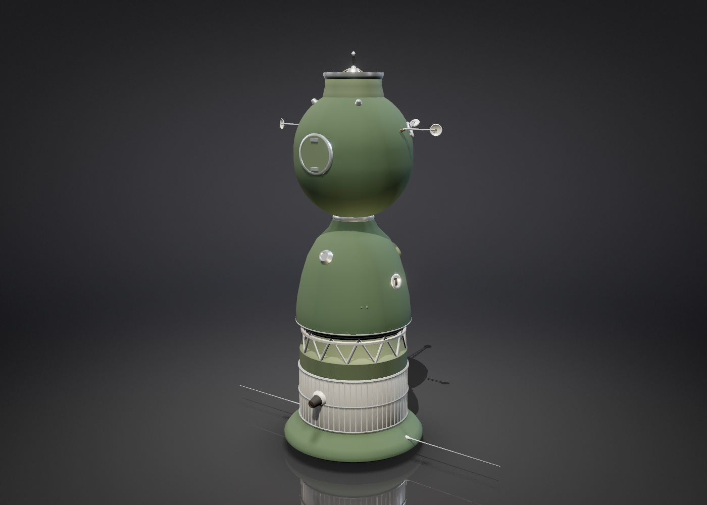

# Soyuz 12

**27–29 September 1973 UTC · Vasily Lazarev and Oleg Makarov · Ural (Урал) · Soyuz 7K-T No. 37 · Soyuz 11A511 · Tyuratam, Site 1**

Soyuz 12 was the first Soviet crewed mission after Soyuz 11 depressurized during return in 1971,
killing all three cosmonauts. The redesigned ferry made room for two suited cosmonauts and
their suit support equipment. Lazarev and Makarov flew a two-day test on batteries after the
loss of the station they had trained to visit. [RGANTD, *Flight of the Urals*](https://mail.rgantd.ru/news/pamyatnye-daty/polet-uralov/) ·
[NASA, *Mir Hardware Heritage*, §1.8](https://www.nasa.gov/wp-content/uploads/static/history/SP-4225/documentation/mhh/mirhh-part1.pdf) ·
[Zak, *USSR resumes crew missions after deadly accident*](https://russianspaceweb.com/soyuz12.html)

## The flight

- **27 September, 12:18:16 UTC.** Commander Vasily Lazarev and flight engineer Oleg Makarov
  lifted off from Site 1 in Sokol-K pressure suits. The contemporary Soviet report gave an
  initial orbit of 194 × 249 km. NASA's contemporary chronology gives 180 × 229 km.
  [Afanasyev and Vorontsov, *The First Soyuz Spacecraft*, flight chronology](https://epizodsspace.airbase.ru/bibl/mpk/mpk.pdf) ·
  [*Nauka i zhizn*, *Flights Continue*, 1973](https://www.nkj.ru/archive/articles/52879/) ·
  [NASA, *Astronautics and Aeronautics, 1973*, p. 273](https://www.nasa.gov/wp-content/uploads/2023/04/1973.pdf)
- **First day in orbit.** The crew exercised manual and automatic flight controls and raised
  the orbit to a reported 326 × 345 km at 51.6°. Siddiqi places the burn within seven hours of
  launch. Zak reports a different timing and a higher final orbit. The Gallery uses the
  contemporary reports for both altitude pairs and gives the burn time as approximate.
  [NASA, *Astronautics and Aeronautics, 1973*, p. 273, citing TASS](https://www.nasa.gov/wp-content/uploads/2023/04/1973.pdf) ·
  [Siddiqi, *Challenge to Apollo*, p. 816](https://www.nasa.gov/wp-content/uploads/static/history/SP-4408pt2.pdf) ·
  [Zak, *Soyuz 12*](https://russianspaceweb.com/soyuz12.html)
- **Work in orbit.** Siddiqi records a depressurization test of the new pressure suits
  during the flight. Makarov used the portable LKSA-3 to record terrain in six spectral bands.
  Lazarev photographed the same targets with a conventional camera. Teams in aircraft made
  parallel observations to help assess the effect of the atmosphere. Later accounts also
  describe problems with temperature control and intermittent faults in the ion attitude system.
  [Space Research Institute, *IKI at 50*, pp. 156 and 167](https://iki.cosmos.ru/sites/default/files/publications/2015iki50.pdf) ·
  [Siddiqi, p. 816](https://www.nasa.gov/wp-content/uploads/static/history/SP-4408pt2.pdf) ·
  [Zak, *Soyuz 12*](https://russianspaceweb.com/soyuz12.html)
- **29 September, 11:33:48 UTC.** After the braking burn and module separation, the crew
  returned in the descent capsule in their pressure suits. Parachutes slowed the capsule,
  and soft-landing rockets fired just above the ground. Both landed safely about 400 km
  southwest of Karaganda after 31 orbits and 1 day, 23 hours, 15 minutes, 32 seconds.
  [*Nauka i zhizn*, *Flights Continue*](https://www.nkj.ru/archive/articles/52879/) ·
  [Afanasyev and Vorontsov, flight chronology](https://epizodsspace.airbase.ru/bibl/mpk/mpk.pdf) ·
  [Siddiqi, appendix Table IB](https://www.nasa.gov/wp-content/uploads/static/history/SP-4408pt2.pdf)

## Gallery

Inspect the 11A511 launcher, the battery-powered ferry, the LKSA-3 camera, and the two suited
cosmonauts at the Sirius controls. The slider opens the fairing, deploys the reconstructed
antennas, and later spreads the three modules for inspection.
The Launch site and Fly are pending. [Spacecraft record](spacecraft.md)

[Assembled launcher](../../../../../docs/readme/soyuz-12/launcher.jpg) ·
[Instrument and propulsion module](../../../../../docs/readme/soyuz-12/service-module.jpg) ·
[Descent cabin](../../../../../docs/readme/soyuz-12/descent-cabin.jpg) ·
[Sirius controls from Lazarev's couch](../../../../../docs/readme/soyuz-12/sirius.jpg) ·
[LKSA-3 multispectral camera](../../../../../docs/readme/soyuz-12/lksa-camera.jpg) ·
[Separated spacecraft modules](../../../../../docs/readme/soyuz-12/separation.jpg)
