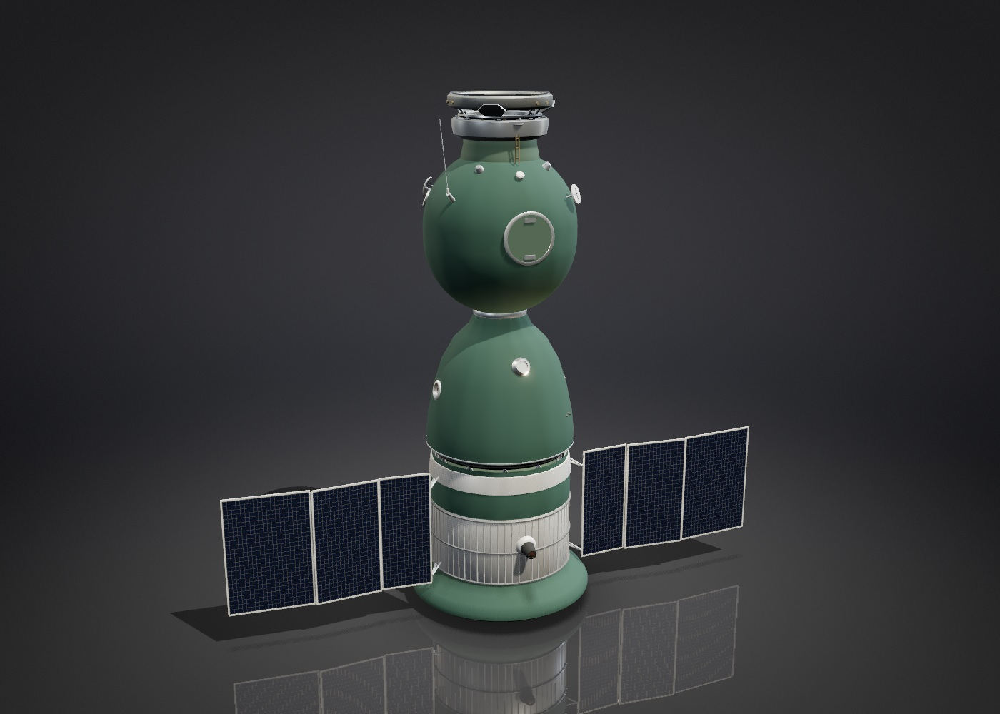

# Soyuz 16

**2–8 December 1974 UTC · Anatoly Filipchenko and Nikolai Rukavishnikov · Buran (Буран) · Soyuz 7K-TM No. 73 · Soyuz-U · Tyuratam, Site 1**

Soyuz 16 was the crewed rehearsal for the Soviet side of the Apollo–Soyuz Test Project. The two
cosmonauts repeated procedures planned for the joint flight and tested the redesigned life support
and docking equipment. Two uncrewed flights, Kosmos 638 and Kosmos 672, had already tested the
variant. Soyuz 16 carried a ring on its own docking port to stand in for the docking interface it
would meet the following July. [NASA, *Soviet Rehearsal for Apollo-Soyuz*](https://www.nasa.gov/history/45-years-ago-soviet-rehearsal-for-apollo-soyuz/) ·
[NASA, *Mir Hardware Heritage*, §1.9](https://www.nasa.gov/wp-content/uploads/static/history/SP-4225/documentation/mhh/mirhh-part1.pdf)

## The flight

- **2 December, 09:40:00 UTC.** Commander Anatoly Filipchenko and flight engineer Nikolai
  Rukavishnikov lifted off from Site 1 aboard Soyuz-U K 15000-014. A contemporary TASS report
  gave an early orbit of 194 × 280 km at 51.8°. After launch the Soviets supplied orbital data
  to NASA, whose stations tracked the spacecraft as a rehearsal for the joint flight. At liftoff
  the Site 1 geometric Sun was at azimuth 209.9° true and elevation +16.5°. The Moon was at
  351.6° true and −25.2°, below the horizon. Both positions are computed with DE440.
  [McDowell, *General Catalog of Artificial Space Objects*, R-7 launch log](https://www.planet4589.org/space/gcat/data/launch/R-7.html) ·
  [NASA, *Astronautics and Aeronautics, 1974*, pp. 207–208](https://www.nasa.gov/wp-content/uploads/2023/04/1974.pdf)
- **First day in orbit.** The crew lowered the cabin pressure to about 540 mmHg (10.4 psi).
  TASS reported an increase from 20% to 40% oxygen. The change shortened the acclimation
  period planned for the crew transfers, which would use the American docking module as an
  airlock. The rehearsal included later pressure changes and checks of airflow between the
  Soyuz modules. [NASA, *The Partnership*, ch. 9, life-support timeline](https://www.apolloexplorer.co.uk/books/sp-4209/ch9-9.htm) ·
  [NASA, *Astronautics and Aeronautics, 1974*, p. 207](https://www.nasa.gov/wp-content/uploads/2023/04/1974.pdf)
- **3–4 December.** Orbit corrections brought Soyuz to a reported near-circular orbit about
  225 km high, with a period of 88.9 minutes. The Soviet account places corrections on
  revolutions 17 and 18 under 3 December. NASA's chronology places the circular orbit
  correction on 4 December. The NSSDC catalogue lists a separate 3 December tracking
  epoch at 177 × 223 km. [TASS, *Science in Siberia*, no. 49, p. 1](https://www.sbras.info/system/files/archive/archive1961-2009/1974_49.pdf) ·
  [NASA, *Astronautics and Aeronautics, 1974*, p. 207](https://www.nasa.gov/wp-content/uploads/2023/04/1974.pdf) ·
  [NASA NSSDC orbital catalogue, 1974-096A](https://ntrs.nasa.gov/api/citations/19780022215/downloads/19780022215.pdf)
- **Docking tests.** The crew exercised the capture and separation modes against the simulator
  ring. Soviet reporting places the first tests on revolution 32. On 7 December at 09:00 UTC
  the crew fired the emergency release. A camera in the orbital module recorded the ring moving
  clear.
  [NASA, *The Partnership*, ch. 9, elapsed time 119:20](https://www.apolloexplorer.co.uk/books/sp-4209/ch9-9.htm) ·
  [TASS, *Science in Siberia*, no. 49, p. 1](https://www.sbras.info/system/files/archive/archive1961-2009/1974_49.pdf) ·
  [NASA, *Astronautics and Aeronautics, 1974*, p. 207](https://www.nasa.gov/wp-content/uploads/2023/04/1974.pdf) ·
  [Zak, *The USSR launches dress rehearsal for a joint mission with Apollo*, ring sequence](https://www.russianspaceweb.com/soyuz16.html)
- **8 December, 08:03:35 UTC.** The descent capsule landed safely about 300 km north of
  Dzhezkazgan in Kazakhstan, 5 days, 22 hours, 23 minutes and 35 seconds after liftoff.
  [Afanasyev and Vorontsov, *The First Soyuz Spacecraft*, flight chronology](https://epizodsspace.airbase.ru/bibl/mpk/mpk.pdf) ·
  [NASA, *Astronautics and Aeronautics, 1974*, p. 207](https://www.nasa.gov/wp-content/uploads/2023/04/1974.pdf)

## The flight as flown

From [mission.md](mission.md). The ascent is flown on the **Soyuz-U, 11A511U**, its first flight with a crew: the 11A511's
blocks with the 11A511U's own engines, their thrusts the type's table's, and its gain over the 11A511 sized on Block I's mass
from the type's documented capability (a Soyuz T of 6,855 kg to a mean height of 220 km), not from this flight. On Soyuz 3's
instants Block I is cut on the orbit at 531.9 s with 9 kg left, level at 191.7 km: **191.7 by 301.9 km** osculating, within
Siddiqi's 191.7 by 314.8 (a mean; TASS gave 194 by 280). The 17th and 18th revolutions' corrections are flown as two burns at
the apsides, each of the impulse that joins the published orbits: **219.5 by 226.0 km, 88.6 min**, where the joint flight's
assembly orbit was about 225 km and 88.9 min. **The docking ring is shot off on 7 December**, 119 h 20 min in, and flies on
by itself. The braking burn, timed for the landing place, brings Filipchenko and Rukavishnikov down in their Sokol-K suits on
the descent module's own lift: at most **3.0 g**, on the ground at 3.4 m/s **161 km across the track** from McDowell's point
and 962 s early. Every miss is recorded in src/sim/misses.ts, nothing adjusted.

**Flown live, guidance and sequencer on, it breaks up at T+57.** The day's winter jet (ERA5: some 30 m/s from the north at
11 to 13 km, across the track) puts the stack five degrees off the air at 40 kPa, and its bending load passes the R-7's limit,
3,340 Pa rad, by a per cent. That limit is an estimate (Soyuz-2's tolerance with a half again for strength); Soyuz 4 in
January reaches 98 per cent of it, Soyuz 12 84 and Soyuz T-2 74. Soyuz 16 flew, so this is not believed to be what happened:
the vehicle was stronger than the estimate, or met the wind at a smaller angle than the law is flown at. The R-7's normal and
lateral stabilisation held the centre of mass to the trajectory (Startsev, 2016), which is not load relief, and none for the
11A511U was found; the limit is not widened to let this flight through. The recorded run (the launch site's clock, the idle
show, the as-flown replay and every check) has no breakup. The miss is in src/sim/misses.ts (`aloft`).

What the run does not do:

- The first of the three corrections (the 4th or 5th revolution): what it did is on no record read.
- The docking tests: the ring is let go once, at the emergency release; its retractions and re-engagements are not flown.
- The braking burn's instant and the parting: the record has neither, and Soyuz 10's and Soyuz 11's are taken.
- The descent control system's rolls: the lift is held up throughout.
- The cabin's lowered pressure and raised oxygen, the colour television, the joint tracking with NASA and the experiments.
- The second-generation escape system: its tower flies the first tower's estimated mass, and no escape is flown.

## Gallery

The slider opens the Soyuz-U fairing, unfolds the solar arrays, releases the Apollo simulator ring
and spreads the three modules for inspection. Look into the descent capsule to see both suited
cosmonauts and take either couch to look at the reconstructed controls. [Spacecraft record](spacecraft.md)

[Assembled Soyuz-U launcher](../../../../../docs/readme/soyuz-16/launcher.jpg) ·
[APAS-75 docking system](../../../../../docs/readme/soyuz-16/apas.jpg) ·
[Apollo simulator ring](../../../../../docs/readme/soyuz-16/test-ring.jpg) ·
[Instrument and propulsion module](../../../../../docs/readme/soyuz-16/service-module.jpg) ·
[Descent cabin](../../../../../docs/readme/soyuz-16/descent-cabin.jpg) ·
[Sirius controls from Filipchenko's couch](../../../../../docs/readme/soyuz-16/sirius.jpg) ·
[Separated spacecraft modules](../../../../../docs/readme/soyuz-16/separation.jpg)

## Launch site

The launcher hangs above the Site 1 flame pit between the paired Soyuz service towers. Advance the pad slider to lower the towers. The opening time and clearance interval are illustrative. The sky is the day's: clear and hard, −13 °C, with 13 m/s from the east-north-east at Dzhusaly, 74 km south-east, at 09:00 UTC ([weather.ts](weather.ts); NOAA ISD). ERA5 supplies the surrounding hours and the air aloft. [Pad model, sources and simplifications](../../../places/tyuratam/site-1.md#soyuz-crews-at-site-1-19671980)

Walk as Filipchenko or Rukavishnikov in their Sokol-K pressure garments. Each walk starts on the rail apron facing the launcher. The starting positions, footwear and garment details are reconstructed.
