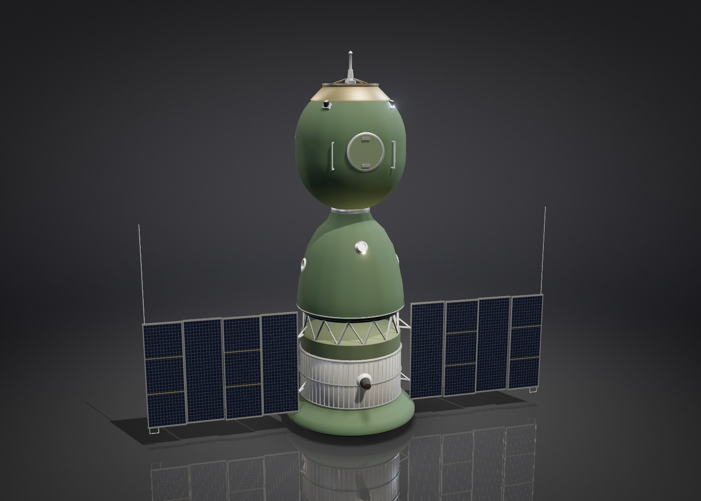

# Soyuz 3

**26–30 October 1968 · Georgiy Timofeyevich Beregovoy · Argon (Аргон) · Soyuz 7K-OK(A) No. 10 · Soyuz 11A511 · Tyuratam, Site 31**

Soyuz 3 returned Soviet cosmonauts to orbit after Vladimir Komarov's death on Soyuz 1.
Before it, two pairs of uncrewed spacecraft docked automatically, and Kosmos 238 rehearsed
a solo flight. This time Beregovoy was to dock with the uncrewed Soyuz 2, a passive 7K-OK
launched the previous day. That was spacecraft No. 11, distinct from the unlaunched Soyuz 2
planned to meet Komarov. [Energia corporate history, pp. 157–195](https://testpilot.ru/espace/bibl/energia-50/05.php)

## The flight

- **25 October.** Soyuz 2 went up uncrewed from Site 1. Its docking cone would receive the
  active probe on Soyuz 3. [TASS in *Pravda*, 27 October 1968, p. 1](https://852410.selcdn.ru/marxism_leninism_library/marxism-leninism/papers/pravda/%D0%9F%D1%80%D0%B0%D0%B2%D0%B4%D0%B0_1968/%D0%9F%D1%80%D0%B0%D0%B2%D0%B4%D0%B0%2C%201968%20%2C%20%E2%84%96%20301.pdf)
- **26 October.** Beregovoy launched at 08:34:18 UTC. The contemporary announcement gave the
  time to the minute and reported an initial orbit of 205 × 225 km, with an inclination of
  51°40′ and a period of 88.6 minutes. Kamanin recorded about 11 km between the two ships after
  insertion. The automatic Igla system brought them to about 200 m before Beregovoy took
  over. [TASS in *Pravda*, p. 1](https://852410.selcdn.ru/marxism_leninism_library/marxism-leninism/papers/pravda/%D0%9F%D1%80%D0%B0%D0%B2%D0%B4%D0%B0_1968/%D0%9F%D1%80%D0%B0%D0%B2%D0%B4%D0%B0%2C%201968%20%2C%20%E2%84%96%20301.pdf) · [Kamanin's diary, 26 and 31 October](https://militera.lib.ru/db/kamanin_np/68.html) · [Afanasyev and Vorontsov, *The First Soyuz Spacecraft*](https://epizodsspace.airbase.ru/bibl/mpk/mpk.pdf)
- **Final approach.** At the 31 October debrief, Beregovoy described holding at 30–40 m in
  darkness when the target's lamps would not line up as expected, then trying to close again
  after daylight. A telemetry review found the spacecraft inverted relative to one another.
  He also reported knocking a control while reaching for a camera and finding that it was
  firing the thrusters. With propellant depleted, the ships never docked. Kamanin questioned
  the timing of the attempt, the differences between the trainer and the spacecraft, and
  the complexity of using the lights so soon after reaching weightlessness.
  [Kamanin's diary, 29 and 31 October](https://militera.lib.ru/db/kamanin_np/68.html)
- **28–29 October.** Soyuz 2 landed on the 28th. Beregovoy stayed aloft and continued testing
  orientation and manoeuvring, observing the Earth and transmitting reports from both
  habitable compartments. [Kamanin's diary, 28–29 October](https://militera.lib.ru/db/kamanin_np/68.html) · [TASS dispatches and press conference](https://epizodsspace.airbase.ru/bibl/osvoen-kosm-pr-sssr/1968-1970/02.html)
- **30 October.** The first ground command for descent did not register, so controllers
  sent it again. After Beregovoy set up the ship by hand, its orientation system found the
  required ion flow. Mishin recorded the start of the braking burn at 06:45:05 UTC. The parachute and soft-landing motors
  worked. The capsule landed at 07:25:03 UTC, about 70 km north of Karaganda, after
  3 days, 22 hours, 50 minutes and 45 seconds.
  [Kamanin's diary, 30 October](https://militera.lib.ru/db/kamanin_np/68.html) · [Mishin's diary and other sources](../../../../../docs/sources.md#soyuz-3-gallery) · [Afanasyev and Vorontsov, *The First Soyuz Spacecraft*](https://epizodsspace.airbase.ru/bibl/mpk/mpk.pdf)

## Gallery

The exhibit shows spacecraft No. 10 on an early 11A511. The spacecraft view brings the ship
down to the gallery floor. The slider opens the fairing, then shows both solar wings deployed
while the three spacecraft modules are still joined. Farther along, the pieces separate for
inspection. The cabin cutaway shows the Sirius-7K panel and Beregovoy in the centre couch.
The spacecraft record explains which details belong to No. 10 and which follow the 7K-OK type.
[Spacecraft record](spacecraft.md)

The Gallery uses studio light. The Launch site, historical weather and flyable trajectory are pending.

[Assembled launcher](../../../../../docs/readme/soyuz-3/launcher.jpg) · [Orbital workroom](../../../../../docs/readme/soyuz-3/orbital-cabin.jpg) · [Beregovoy in the descent cabin](../../../../../docs/readme/soyuz-3/descent-cabin.jpg) · [Sirius console from the centre couch](../../../../../docs/readme/soyuz-3/sirius.jpg) · [Separated spacecraft modules](../../../../../docs/readme/soyuz-3/separation.jpg)
