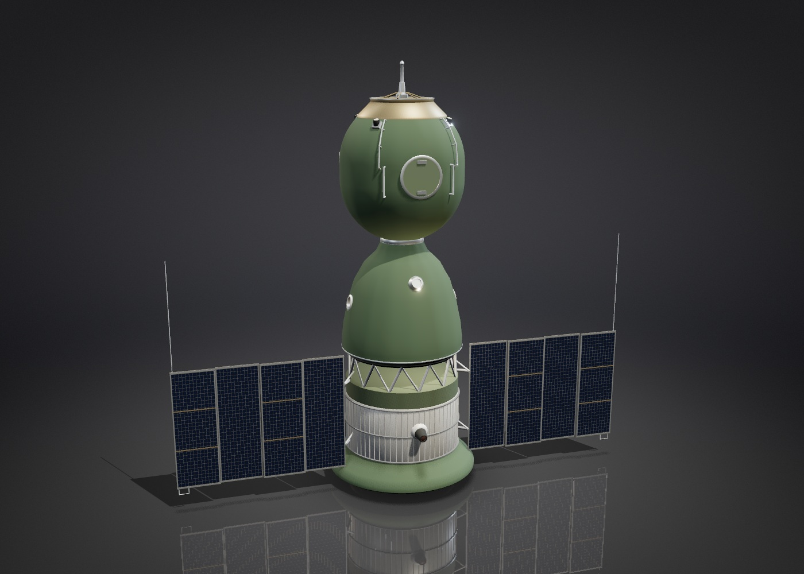

# Soyuz 4

**14–17 January 1969 · Vladimir Aleksandrovich Shatalov · Amur (Амур) · Soyuz 7K-OK(A) No. 12 · Soyuz 11A511 · Tyuratam, Site 31**

Soyuz 4 and 5 made the first docking between two crewed spacecraft. The joint latched the two
ships and connected their electrical systems. Crew had to move between the ships in spacesuits
because the probe and cone provided no passage. The operation tested rendezvous, docking and crew
transfer procedures that the Soviet lunar programme could use. [January 1969 crew press conference,
NASA translation, pp. 2–5](https://ntrs.nasa.gov/api/citations/19690007583/downloads/19690007583.pdf) ·
[NASA, *Mir Hardware Heritage*, §1.3.3](https://www.nasa.gov/wp-content/uploads/static/history/SP-4225/documentation/mhh/mirhh-part1.pdf)

## The flight

- **14 January.** Shatalov launched alone at 07:30 UTC from Site 31. In orbit he turned the solar
  wings toward the Sun and fired the correction engine to set up the next day's rendezvous.
  [Shatalov's press conference, pp. 3–4](https://ntrs.nasa.gov/api/citations/19690007583/downloads/19690007583.pdf) ·
  [Sven Grahn, tracking account](https://planet4589.org/space/archive/sven/trackind/soyuz45/soyuz45.html)
- **15 January.** Boris Volynov, Yevgeniy Khrunov and Aleksey Yeliseyev launched aboard Soyuz 5
  from Site 1. Shatalov reported seeing the trail of their launch vehicle when he passed near
  Tyuratam. Both ships manoeuvred to set up the automatic approach.
  [Crew press conference, pp. 4, 6](https://ntrs.nasa.gov/api/citations/19690007583/downloads/19690007583.pdf) ·
  [Kamanin's diary, 15 January](https://militera.lib.ru/db/kamanin_np/69.html)
- **16 January, 08:20 UTC.** Igla guided the automatic approach. At about 100 m both commanders
  switched to manual control. Shatalov checked the approach through his optical sight and on
  television. Soyuz 4's probe entered Soyuz 5's cone, and the two spacecraft locked together.
  [Shatalov's press conference, pp. 4–5](https://ntrs.nasa.gov/api/citations/19690007583/downloads/19690007583.pdf) ·
  [TASS docking communiqué, 17 January](https://docs.historyrussia.org/ru/nodes/414991-soobschenie-tass-o-stykovke-kosmicheskih-korabley-locale-nil-soyuz-4-locale-nil-i-locale-nil-soyuz-5-locale-nil-17-yanvarya-1969-g)
- **16 January, transfer and separation.** The two commanders remained in their sealed descent
  cabins while both orbital modules were depressurized. Khrunov and Yeliseyev made their way
  outside from Soyuz 5 to the side hatch of Soyuz 4, bringing letters and newspapers for Shatalov.
  The ships separated around 12:55 UTC after 4 hours and 35 minutes together.
  [Crew press conference, pp. 5–7](https://ntrs.nasa.gov/api/citations/19690007583/downloads/19690007583.pdf) ·
  [NASA, *Astronautics and Aeronautics, 1969*, 14–18 January](https://www.nasa.gov/wp-content/uploads/2023/04/1969.pdf)
- **17 January.** Shatalov began braking for entry at 06:11 UTC. Soyuz 4 landed at 06:50:47 UTC
  with all three cosmonauts aboard, about 40 km northwest of Karaganda. Kamanin recorded that
  Shatalov kept reporting during descent using the capsule's slot antenna and then an antenna
  in the parachute line.
  [Shatalov's press conference, p. 5](https://ntrs.nasa.gov/api/citations/19690007583/downloads/19690007583.pdf) ·
  [Kamanin's diary, 17 January](https://militera.lib.ru/db/kamanin_np/69.html) ·
  [Afanasyev and Vorontsov, *The First Soyuz Spacecraft*, Soyuz 4/5 chapter](https://epizodyspace.ru/bibl/mpk/mpk.pdf)

The Gallery uses the 173.7 × 235.3 km orbit, 51.72° inclination and 6,625 kg mass in Siddiqi’s
orbital-flight table. NASA’s 1969 chronology records the contemporary preliminary announcement
of 213 × 224 km. [Siddiqi, *Challenge to Apollo*, appendix, Table I](https://www.nasa.gov/wp-content/uploads/static/history/SP-4408pt2.pdf) · [NASA, *Astronautics and Aeronautics, 1969*, 14–18 January](https://www.nasa.gov/wp-content/uploads/2023/04/1969.pdf)

## Gallery

Inspect the early 11A511 and its escape tower, the spacecraft with both solar wings deployed,
the active probe and exterior handholds, or the Sirius-7K panel from Shatalov's centre couch.
The cutaway shows Shatalov and his two empty return places as they were at launch. The slider
illustrates deployment and separates the three spacecraft modules for inspection. [Spacecraft record](spacecraft.md)

## Launch site

The launcher stands over [Site 31’s excavated pad](../../../places/tyuratam/site-31.md). The site opens at an estimated two hours before launch. The crew lift reaches the boarding platform while the towers stand around the rocket. The towers fold clear before liftoff. At liftoff the Sun was at azimuth 173.8° true and elevation +22.4°. The Moon was at 227.3° and +3.8°. The viewing conditions use the place’s estimated sky.

[Assembled launcher](../../../../../docs/readme/soyuz-4/launcher.jpg) · [Spacewalk transfer hatch](../../../../../docs/readme/soyuz-4/transfer-hatch.jpg) · [Descent cabin](../../../../../docs/readme/soyuz-4/descent-cabin.jpg) · [Sirius console from the centre couch](../../../../../docs/readme/soyuz-4/sirius.jpg) · [Separated spacecraft modules](../../../../../docs/readme/soyuz-4/separation.jpg)

On foot, Shatalov starts on the approach facing the spacecraft. His standing figure uses the reconstructed cabin clothing and communications cap. The apron position and outdoor clothing are illustrative.
