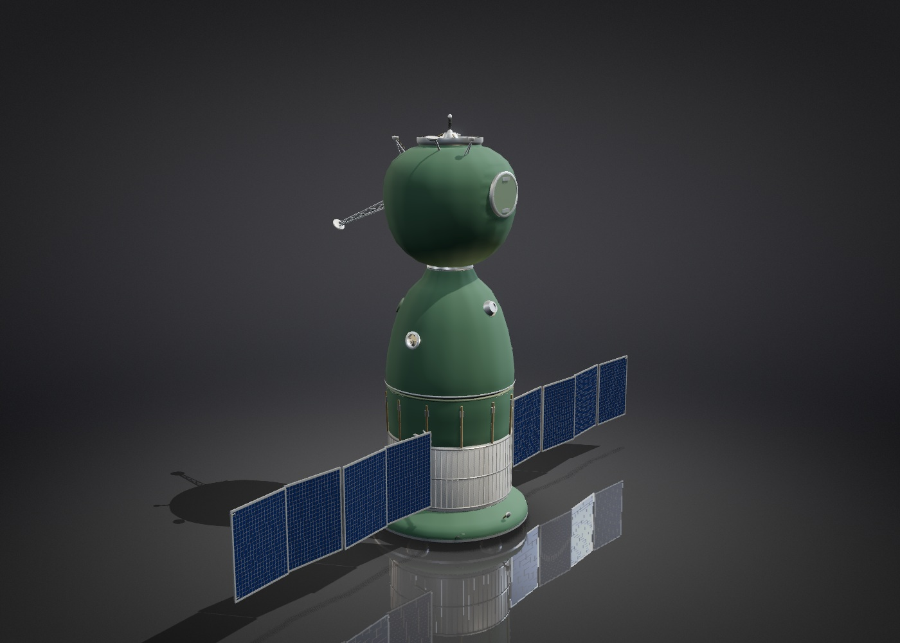

# Soyuz T-2

**5–9 June 1980 UTC · Yuri Malyshev and Vladimir Aksyonov · Yupiter (Юпитер) · Soyuz 7K-ST No. 7L · Soyuz-U · Tyuratam, Site 1**

This was the first crewed flight of Soyuz-T, the successor to the two-person Soyuz ferry. The
new ship brought back solar power, carried the Argon-16 digital flight computer and could
accommodate three cosmonauts in pressure suits. Malyshev and Aksyonov flew as a pair to test it
at Salyut 6. The uncrewed Soyuz T-1 had already docked with the station during testing.
[NASA, *Mir Hardware Heritage*, §§1.12.2–1.12.3](https://www.nasa.gov/wp-content/uploads/static/history/SP-4225/documentation/mhh/mirhh-part1.pdf)

## The flight

- **5 June, 14:19:30 UTC.** Commander Yuri Malyshev and flight engineer Vladimir Aksyonov
  lifted off from Site 1 aboard Soyuz-U Zh15000-196. Before docking, they pointed Soyuz at
  the Sun to check its solar arrays. At liftoff the Site 1 geometric Sun was at azimuth
  291.9° true and elevation +10.4°. The Moon was at 19.6° true and −53.0°. Both positions
  are computed with DE440.
  [McDowell, R-7 launch log, 1980-045](https://www.planet4589.org/space/gcat/data/launch/R-7.html) ·
  [NASA, *Astronautics and Aeronautics, 1979–1984*, p. 177](https://www.nasa.gov/wp-content/uploads/2023/04/1979-1984.pdf)
- **6 June, 15:58 UTC.** Soyuz T-2 docked at Salyut 6’s aft port. TASS gave about 180 m as
  the range at which the crew took over. Instructor V. I. Vasilyev gives about 200 m
  for the computer’s request for braking authorization during the planned semiautomatic
  approach. He traces the interruption to a delay confirming that request. The guidance
  algorithm selected the main engine and turned the spacecraft to brake, at which point
  Igla lost radar lock. Malyshev withdrew safely, regained sight of the station and
  docked by hand.
  [NASA, *Astronautics and Aeronautics, 1979–1984*, p. 177](https://www.nasa.gov/wp-content/uploads/2023/04/1979-1984.pdf) ·
  [Vasilyev, Soyuz-T training account, pp. 130–131](https://www.gctc.ru/media/files/Periodicheskie_izdaniya/ppk_2021_4_total_41/9_stat.a_vasil.ev.pdf)
- **6–9 June.** The visitors worked alongside Leonid Popov and Valery Ryumin. The station’s
  resident crew had moved Soyuz 36 from aft to forward the day before Soyuz T-2 launched,
  freeing the aft port for the test flight. The visitors brought instruments, mail and fresh
  food in the orbital module, and continued checking Soyuz-T’s systems at the station.
  [NASA, *Mir Hardware Heritage*, §2.7.3.4](https://www.nasa.gov/wp-content/uploads/static/history/SP-4225/documentation/mhh/mirheritage.pdf) ·
  [Baturin (ed.), *Mirovaya pilotiruyemaya kosmonavtika*, pp. 288–289](https://epizodsspace.airbase.ru/bibl/mpk/mpk.pdf)
- **9 June, 12:39 UTC.** The visitors returned in their own spacecraft. After undocking they
  shed the orbital module before the braking burn. Argon-16 handled the return maneuvers
  while the crew monitored the sequence. The capsule landed about 200 km southeast of
  Dzhezkazgan, 3 days, 22 hours, 19 minutes and 30 seconds after launch by the Russian
  mission record.
  [Baturin (ed.), *Mirovaya pilotiruyemaya kosmonavtika*, pp. 288–289](https://epizodsspace.airbase.ru/bibl/mpk/mpk.pdf)

## The flight as flown

From [mission.md](mission.md). The ascent is flown on the **Soyuz-U, 11A511U** (the 11A511's blocks with its own engines and
its gain sized from the type's own table, a Soyuz T of 6,855 kg to a mean height of 220 km, not from this flight) and on
Soyuz 3's instants: Block I runs dry at 532.0 s, level at 202 km, on **202.0 by 224.9 km** osculating where 202 by 249 km is
given for this flight (Spacefacts, Russian Wikipedia; Encyclopedia Astronautica's 195 by 232 km would hold). The fourth
revolution's two-impulse raise is flown as two burns at the apsides, each of the impulse that joins the insertion orbit to the
one McDowell gives the ship on 6 June: **263.2 by 302.9 km** (262 by 317). **The rendezvous and docking with Salyut 6 are not
flown**: the station is not in the plan; the approach, Malyshev's docking by hand and the three days docked are the record's
events, and the ship waits in that orbit. The orbital module is let go a revolution after the undocking, before the braking
burn, as on every Soyuz T; the burn, timed for the landing place, brings Malyshev and Aksyonov down on the descent module's own
lift: at most **3.0 g**, on the ground at 3.8 m/s **98 km across the track** from the point "200 km south-east of Dzhezkazgan"
and 827 s late. Every miss is recorded in src/sim/misses.ts, nothing adjusted.

What the run does not do:

- The rendezvous with Salyut 6: the far approach on the last revolution of the first day, the semi-automatic approach given up
  near 200 m when the computer's request to brake was confirmed late, the docking by hand at the aft port, the joint work
  with Popov and Ryumin and the undocking. The ship stays in the phasing orbit, not the station's.
- The approach and attitude thrusters (DPO) that shared the main engine's tanks: only what the main engine burns is carried.
- The braking burn's instant and length and the parting: the record has none of them; Soyuz 10's, Spacefacts' and Soyuz 11's
  are taken.
- The descent control system's steering to the landing place: the lift is held up throughout.
- The Argon-16 and the Neptun console: the sequence flies the record's steps as every Soyuz's does.
- The Soyuz T's escape system: its tower flies the first tower's estimated mass, and no escape is flown.

## Gallery

Open the Soyuz-U fairing, deploy the solar wings and spread the spacecraft modules with the
slider. Open the descent cabin and take either cosmonaut’s couch, or inspect the Neptun
console on its own. [Spacecraft record](spacecraft.md)

[Assembled Soyuz-U launcher](../../../../../docs/readme/soyuz-t-2/launcher.jpg) ·
[Docking probe and collar](../../../../../docs/readme/soyuz-t-2/docking.jpg) ·
[Descent cabin](../../../../../docs/readme/soyuz-t-2/descent-cabin.jpg) ·
[Instrument and propulsion module](../../../../../docs/readme/soyuz-t-2/service-module.jpg) ·
[Neptun console](../../../../../docs/readme/soyuz-t-2/console.jpg) ·
[Combined propulsion system](../../../../../docs/readme/soyuz-t-2/propulsion.jpg) ·
[Separated spacecraft modules](../../../../../docs/readme/soyuz-t-2/separation.jpg)

## Launch site

The launcher hangs above the Site 1 flame pit between the paired Soyuz service towers. Advance the pad slider to lower the towers. The opening time and clearance interval are illustrative. The sky is the day's: cloudless and hot, 28 °C, with 3 m/s from the east at Dzhusaly, 74 km south-east, at 15:00 UTC ([weather.ts](weather.ts); NOAA ISD). ERA5 supplies the surrounding hours and the air aloft. [Pad model, sources and simplifications](../../../places/tyuratam/site-1.md#soyuz-crews-at-site-1-19671980)

Walk as Malyshev or Aksyonov in the Sokol KV-2. Its paired chest closures and central regulator distinguish it from the earlier Sokol-K. Each walk starts on the rail apron facing the launcher. The starting positions, footwear and garment details are reconstructed.
